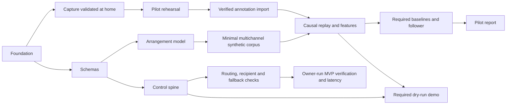

# Roobotto Implementation Plan & Scope Audit

**Target:** [implementation-plan.md](implementation-plan.md), version 1.0 · [README.md](../README.md) · [.gitignore](../.gitignore)  
**Baseline:** [Conceiving the Roobotto Project](../Conceiving_the_Roobotto_Project-2026-10-16.html)  
**Reviewed:** 17 October 2026. This revision audits both the plan and the preceding audit. Only this audit was changed; recommendations below have **not** been applied to the plan.

---

## 1. Executive Assessment

The architecture and staged autonomy strategy are reasonable, but the plan needs clearer contracts for gesture commitment, fallback routing, cue identity, performer authorization, and replay before those components are implemented. Foundation work can proceed; this review does not justify blocking every task until every finding is resolved.

The previous audit caught a real gesture conflict and useful capture/reproducibility risks. It overstated several diagnoses, proposed an unsafe control remapping, and recommended deferring prerequisites for the physical bench work it retained. Its claim that Phase 0 is definitively over-scoped is not established: weekly availability is unanswered, several tasks are already deferrable, and the bench worksheet explicitly continues beyond Phase 0. There is a substantial **capacity risk**, not a measured schedule failure.

**Severity:** High means an unresolved contract can undermine output safety or stage recovery; Medium means it can invalidate acceptance evidence or materially hinder delivery. Findings identify planning defects and failure scenarios, not observed implementation bugs. No application code, test suite, recordings, or bench logs exist in this checkout.

## 2. Technical & Architectural Findings

### F-1: Gesture recognition and immediate GO need one commitment policy — High

**Consequence:** A performer trying to go BACK or freeze automation could first trigger a forward cue if an implementation commits GO before recognizing the gesture.

**Required correction:** Define when a gesture becomes an authorized action, before scheduling any irreversible output. If first-edge immediate GO is retained, give it an unambiguous control. If multiplexing is retained, document the recognition delay and its effect on quantization. Keep BYPASS dedicated and immediate; Switch 2 already owns extend/exit-loop, so reassignment requires a complete control map rather than silently removing that function.

**Basis:** [Modes and override](implementation-plan.md#5-safety-model-and-invariants), lines 193–199, assigns tap/double-tap/hold to one switch and relies on downbeat delay. [Live behavior](implementation-plan.md#8-phase-1-assisted-stage-manager-m1), lines 313–317, permits immediate firing and sends commands early to compensate for device latency. The actual irreversible point may therefore precede the downbeat. The manual-control task lists edge cases but does not specify their outcomes.

**Acceptance:** BACK and MANUAL-hold never first issue GO. Test early, late, and unlocked presses; a second tap before/after the device send deadline; hold while a cue is pending; and BYPASS at every stage. A command already sent cannot be treated as cancellable merely because its audible/visible effect is still pending.

### F-6: Stopping output and restoring the original rig are different operations — High

**Consequence:** Software BYPASS can leave the performer without the original lighting/synth cue path.

**Required correction:** Distinguish “stop Roobotto output” from “restore today's routing” in the mode contract and operator instructions. Only advertise restoration for an action that actually restores and verifies the route. Do not assume the H4 can be switched remotely. Cancel pending work and define deliberate resynchronization before automation resumes.

**Basis:** [Target topology and fallback](implementation-plan.md#103-target-topology-and-fallback), lines 526–532, says preset B filters Helix-to-device commands, while the software switch only stops Roobotto output. [M1](implementation-plan.md#8-phase-1-assisted-stage-manager-m1) promises one-switch return to today's rig. The hardware preset-A path may satisfy that promise; the software stop by itself does not.

**Acceptance:** Starting in preset B, exercise each advertised action and verify its stated result, including subsequent performer cues. Test the physical fallback with the Mac unavailable. Returning from fallback must not release stale pending cues or create two owners of a device.

### F-7: Cue identity must survive scheduler epoch changes — High

**Consequence:** An already-fired one-shot can become eligible again if cancellation or rescheduling changes the key used to identify it.

**Required correction:** Separate a stable logical cue occurrence from the scheduler generation used to invalidate pending work. Keep the fired-occurrence record across generation changes; a genuine new section visit creates a new occurrence. Specify reconnect/restart recovery without reissuing historical one-shots, including uncertain delivery outcomes.

**Basis:** The [message contract](implementation-plan.md#4-architecture-at-a-glance), line 128, includes scheduler epoch in the dedup key. [Invariants](implementation-plan.md#5-safety-model-and-invariants), lines 211–213, simultaneously require no replay after reconnect and at most one output for duplicates in a visit. The control-spine task does not state how these guarantees survive a changed epoch.

**Acceptance:** Fire a scene note, then cancel/reschedule, relocalize, and reconnect within the same visit: no second one-shot. A deliberate repeat with a new visit can fire once. Restart remains unarmed and does not reconstruct past cues as new work.

### F-8: A snapshot observation is not automatically a new GO or critical authorization — High

**Consequence:** Duplicate observations, unrelated snapshot changes, or output-induced notifications could advance sections twice or authorize an unintended critical cue.

**Required correction:** Define which performer actions mean section advance for each song and distinguish them from state observations. Corroboration must be associated with the intended action/occurrence, not merely any event within a recent time window. Select an authoritative input path or verify how duplicate paths are reconciled. Treat output-derived notifications as state evidence, never independent performer authorization; fail closed when provenance cannot be established.

**Basis:** [M1 live behavior](implementation-plan.md#8-phase-1-assisted-stage-manager-m1), lines 318–320, treats incoming CC69 as GO and resets bar count on every press, while the next stage sends CC69 itself. The snapshot bench test checks USB and H4 paths. The Event schema has provenance, but the authorization rule is unspecified. The [Line 6 MIDI manual](https://manuals.line6.com/en/helix-stadium/live/midi) describes snapshot notifications, and [Command Center](https://manuals.line6.com/en/helix-stadium/live/command-center) describes commands associated with recalls; neither establishes this rig's performer-intent mapping or echo behavior.

**Acceptance:** One action received on two paths advances once. A within-section snapshot change does not advance unless explicitly mapped to do so. Preset initialization and automated recalls do not create fresh GO or critical authority. A prior unrelated press cannot corroborate a different critical action.

### F-9: The critical-cue invariant must not appear to expire at M5 — High

**Consequence:** An implementer could remove corroboration at M5 even though that milestone explicitly retains assisted critical cues.

**Required correction:** Keep the corroboration requirement through M5 and require an explicit evidence-backed authority decision for any later relaxation. Make the main invariant, mode rules, and agent draft agree.

**Basis:** [Invariant I-14](implementation-plan.md#5-safety-model-and-invariants), line 220, begins “Before M5”; the [M5 roadmap row](implementation-plan.md#6-roadmap-and-gates), line 236, keeps critical cues ASSISTED, and Appendix A states the invariant without that time limit. “Before M5” is not itself permission to automate afterward, but it is an inconsistent scope for an executable safety rule.

**Acceptance:** At M5, tracker-only critical requests are refused in every mode. Only an explicitly permitted, properly corroborated request can pass; merely changing a milestone or receiving a fresh tracker packet cannot grant authority.

### F-2: Determinism needs an input, clock, and recording contract — Medium

**Consequence:** Replaying the same audio can produce different decisions if the original engine's delivery order, availability times, and timeout events were not captured.

**Required correction:** Preserve process isolation, but put the decision logic behind a deterministic interface with an injected clock. Define exactly which inputs enter the reproducibility claim: engine-delivered state and manual events, ordering/availability, timer progression, configuration, and any random seeds. Record the consumed trace, not just tracker publications. Specify canonical decision hashing separately from run IDs, absolute clock origins, and physical delivery measurements. Identify tracker sessions as well as sequence numbers so restart/reset and old packets have defined handling.

**Basis:** [ADR-006](implementation-plan.md#3-decisions-to-lock-in-during-week-1), [message fields](implementation-plan.md#4-architecture-at-a-glance), [Section 12](implementation-plan.md#12-testing-and-evaluation-tooling), and the replay task. UDP does **not** inherently contradict deterministic decisions given identical delivered inputs. Conversely, an in-process test queue alone does not prove a real rehearsal can be replayed.

**Acceptance:** Replaying a recorded engine-input trace with loss, reordering, simultaneous manual input, staleness, and tracker restart yields identical normalized decisions. Separately test the UDP wrapper and measure real-time deadlines. Reject stale/old-session packets, and do not let reconnection silently restore automated authority.

### F-3: Two sync endpoints do not establish interior alignment or live equivalence — Medium

**Consequence:** A take can match at both endpoints yet contain an interior discontinuity or timing error that compromises cross-feed features and latency evaluation.

**Required correction:** Validate the capture topology and its alignment throughout a 10-minute bench recording using independent intermediate markers or a shared test signal. Record sample indices, capture timestamps, overflow/dropout indications, and channel/clock configuration. Reject or explicitly mark invalid intervals. An Aggregate Device with a selected clock and drift correction is a reasonable option, already anticipated by the plan; it is not a guarantee of sub-millisecond performance.

**Basis:** [Capture specification](implementation-plan.md#9-the-decisive-experiment), the recorder task, and risk R10. Two endpoints support an offset/average-skew estimate, not proof of the entire recording. [Apple's guidance](https://support.apple.com/en-us/102171) explains clock selection and drift correction. [sounddevice documentation](https://python-sounddevice.readthedocs.io/en/latest/api/streams.html) distinguishes ADC sample timestamps from callback invocation time and exposes overflow flags. Callback scheduling jitter alone does not prove captured samples are misaligned.

**Acceptance:** Independently demonstrate the stated ≤1 ms alignment over the test interval and detect an injected discontinuity. Keep retrospective alignment for annotation/measurement separate from follower inputs: an end-of-take marker is not inherently musical-content leakage, but idealized corrected streams must not be presented as proof of live-equivalent capture. Replay original availability and causal alignment, or label that experiment idealized and validate transfer to live capture separately.

### F-10: Quantized timing and immediate fallback need separate acceptance criteria — Medium

**Consequence:** Correct fallback behavior can fail the timing gate, or be silently excluded to make quantization appear better than it is.

**Required correction:** Define the population, reference point, and measurement endpoint for each timing target. Report phase-locked quantized cues, intentional late-window cues, and no-lock fallback cues separately, with total counts and coverage. Define what happens when a press arrives before the downbeat but after the latency-compensated send deadline; preserve the cue's deadline policy.

**Basis:** The [M1 gate](implementation-plan.md#6-roadmap-and-gates), line 232, requires ±80 ms, while [GO handling](implementation-plan.md#8-phase-1-assisted-stage-manager-m1), lines 313–317, allows immediate output up to a quarter-bar late. At 120 BPM in 4/4, that window is 500 ms. The plan also distinguishes scheduler jitter, device latency, and fixture response elsewhere; these are not interchangeable measures.

**Acceptance:** Protocol and tests explicitly cover all three timing populations and a missed pre-send deadline. Report send time and observed effect where available. Unwanted-critical-cue counts include every mode and fallback case.

### F-11: First-time command verification needs a bootstrap procedure — Medium

**Consequence:** The first mapping cannot be verified using a runtime that correctly refuses to send every unverified command; implementers may be tempted to mark it verified prematurely.

**Required correction:** Specify an owner-run, isolated bench verification procedure before importing a mapping into Roobotto's enabled profile. It can use an external manual test tool. Keep production validation and output invariants intact; do not introduce a general unverified-output bypass.

**Basis:** [Output invariants](implementation-plan.md#5-safety-model-and-invariants), line 207, block unverified physical output; schema validation rejects unverified physical profiles, and the device tool sends only verified commands. Yet [the bench worksheet](implementation-plan.md#102-bench-worksheet-wp3-then-ongoing) requires sending candidate notes/commands to establish their behavior.

**Acceptance:** A fresh device moves from unknown to documented to bench-verified with a cited result, without falsely asserting verification or weakening runtime guards. Unknown mappings remain blocked in normal runs and CI.

### F-12: MIDI-assisted experiments must account for how much position information was supplied — Medium

**Consequence:** Strong results using existing snapshot presses could be misread as autonomous audio following, and an added “50% of boundaries” press condition may understate total assistance.

**Required correction:** Report actual performer interventions and boundary information for each method, including overlap between existing MIDI and simulated presses. Keep the audio-only isolated-feed result visible. Exclude output-derived feedback from independent corroboration; describe success with MIDI as success under that sensing/assistance condition.

**Basis:** [Methods and decision rules](implementation-plan.md#9-the-decisive-experiment) add existing MIDI in B5 and simulated presses at 50% of boundaries in B6. M1 recordings retain the player's snapshot presses, potentially supplying section information already. This does not invalidate B5; the plan intentionally values those signals.

**Acceptance:** Reports state how many boundaries each method was told about, by which inputs, and when. Go/no-go conclusions distinguish audio-only performance from performance contingent on performer actions.

### F-4: Musical units versus physical timers — clarification only

The original Medium-severity contradiction is withdrawn. ADR-005 already limits musical units to durations “Inside the model,” and Appendix A says “musical durations.” Neither forbids hardware latency, debounce, or watchdog intervals. A useful clarification is to express arrangement durations in bars/beats, physical intervals in explicit time units, and runtime timestamps through the clock abstraction described in F-2. This is not a standalone implementation blocker.

### F-5: Legacy research environments — bounded setup risk, not “zero value”

The original blanket removal recommendation is withdrawn. Matchmaker cross-checks the custom DTW baseline; madmom/BeatNet compare the beat tracker. Those are distinct purposes, and the plan already caps the latter setup at half a day.

The pin is real for [BeatNet 1.1.3 metadata](https://pypi.org/pypi/BeatNet/1.1.3/json), which requires numba 0.54.1. [That numba release](https://pypi.org/project/numba/0.54.1/) lists macOS ARM support as unofficial. This supports a compatibility risk, not a claim that installation on this user's machine has failed, nor the same diagnosis for Matchmaker.

Keep these comparisons isolated and bounded. If an optional comparison is deferred, name the lost validation and carry it to the relevant baseline milestone. Do not delete the DTW cross-check while still calling its acceptance criterion satisfied. No environment installation was attempted during this audit.

---

## 3. Scope & Schedule Audit

There are **14 task cards: 10 wholly P0, two mixed P0/P1, and two wholly P1**. Twelve cards therefore contain required work. Annotation import and baseline bar-counting are required portions of mixed cards; annotation propagation and DTW are deferrable portions. The bench worksheet contains 14 tests but is labeled “WP3, then ongoing.” Section 7 already permits DTW, full ablations, Helix latency testing, and the HUD to slip.

The schedule remains ambitious because it depends on a usable capture setup, a rehearsal, manual annotation, and several substantial software components. Obtain weekly availability and measure capture/annotation effort before converting working sessions into a reliable calendar estimate. Neither “latency measurement in 10 minutes” nor “four takes annotated in under 30 minutes” had supporting evidence.

### Preserve the critical dependencies

This diagram shows the principal dependency paths, not a claim that every task is sequential or equally sized.

### Reductions that preserve the stated gates

| Item | Corrected recommendation | Required safeguard |
|---|---|---|
| Passive Art-Net observer | May be deferred if the existing video alternative is practical. Its first use is Phase 0 latency measurement, not autonomous lighting. | Preserve the n ≥ 100 latency distribution, a calibrated timing reference, and separate accounting for fixture response. At 240 fps, nominal frame spacing is about 4.17 ms; that alone does not establish end-to-end measurement accuracy. |
| Synthetic renderer | Use simple deterministic pulses/tones and chord changes; acoustic realism is unnecessary. | Keep separate feeds, exact annotations, tempo changes, repeats/skips, causal twins, and stream-specific dropout tests needed by the retained benchmark. Label any omitted comparison deferred. |
| Annotation propagation | Keep optional, as already specified. | Preserve import, validation, and human verification of evaluation boundaries. Do not assume a fixed annotation duration without measurement. |
| Extra feature families | Consider onset and chroma as the first evaluated feature set, not as proven sufficient for every comparison. | Keep input health and missing-feed handling. Report the reduced feature set and defer corresponding ablations explicitly. |
| Bench worksheet | Select tests by enabled commands and actual wiring, rather than a fixed “6 now / 8 later” split. | Before physical MVP output, establish the Mac route, recipient safety, mapping verification, and loop behavior. If preset B is used, document affected original routes and verify preset-A recovery. Replacing today's routing requires its inventory; a physically isolated test fixture can have narrower scope. |
| Other device tests | Helix recall latency, AUM, MicroFreak, and other tests can follow when those outputs are enabled. | Song selection and switch assignment must be verified before their M1 use. A mock-only demo may defer physical routing work, but then it does not complete the required physical latency measurement. |
| Research environments | Use the plan's setup cap and defer optional comparisons explicitly when necessary. | Preserve the purpose and unsatisfied acceptance checks of each deferred comparison. |

### Priority mismatches the original audit missed

- **The required dry-run demo is bundled into a P1 task.** Day-14 criterion 7 requires it, while the HUD/demo card allows the whole bundle to slip. Make the CLI dry-run demo required and the HUD optional; update the card's acceptance language accordingly.
- **Mixed-priority cards have unsplit “Done when” clauses.** The annotation card requires propagation drafts, and the baseline card requires DTW's expected failures, although those portions may slip. Give required and deferred portions separate acceptance checks so Phase 0 completion is unambiguous.
- **Scope cuts are not equivalent to completing unchanged gates.** Any reduced feature/method matrix must appear in the pilot report as reduced scope. Keep safety and physical-output prerequisites even if dates move.

---

## 4. Repository Hygiene & Evidence

1. **Python ignore patterns are genuinely missing.** Include environment directories, bytecode, pytest/ruff/Hypothesis caches, and package metadata as part of foundation work. This audit does not modify [.gitignore](../.gitignore).
2. **The current scaffold is not a failed implementation.** The README accurately states that the application stack is not implemented. Missing source modules, ADRs, and doc stubs are planned deliverables, not defects merely because they do not exist yet.
3. **Documentation roles were conflated in the prior audit.** An authoring guide does not replace vision or prior-art documentation. If the plan intentionally consolidates those council deliverables, identify where their content belongs. Unused Demucs/Whisper/sherpa-onnx claims are already marked unverified; there is no supported reason to assign all of them to M6.
4. **Demo evidence must respect the media policy.** The HUD/demo task requests a committed “recording,” while the plan forbids committed rehearsal audio. Specify a text terminal recording or a silent/synthetic demonstration with no private show data; do not commit pilot audio as proof of the demo.
5. **Documented does not mean rig-verified.** Source spot-checks support the targeted statements cited above, not the whole evidence register or the user's wiring. The Python ≥3.12 claim is supported by the inspected [NumPy](https://pypi.org/project/numpy/), [SciPy](https://pypi.org/project/scipy/), and [librosa](https://pypi.org/project/librosa/) metadata. Dependency resolution, installation, device behavior, and latency still need the plan's intended checks.

## 5. Audit of the Previous Audit & Review Coverage

| Previous conclusion | Disposition in this revision |
|---|---|
| Gesture ambiguity | Retained, with conditional failure wording and a remedy that preserves immediate BYPASS and extend/exit controls. |
| UDP makes deterministic replay impossible | Replaced with the missing delivery/clock/hash contract. Separate-process transport remains compatible with deterministic replay of recorded inputs. |
| Two-device capture necessarily fails; aggregation fixes it | Replaced with measured alignment, discontinuity detection, and a distinction between retrospective correction and live-equivalent inputs. |
| Musical units prohibit physical timers | Withdrawn as a contradiction; optional clarification retained. |
| Legacy research has zero value | Withdrawn; compatibility/setup risk and the cost of deferring independent comparisons retained. |
| All 14 cards and bench tests are mandatory in two weeks | Corrected priorities and ongoing bench scope; unsupported effort estimates removed. |
| Defer routing and fallback tests while retaining physical bench outputs | Replaced with prerequisites determined by the enabled topology. |
| Prior-art documents were replaced by the authoring guide | Corrected; document roles and deferred dependency claims are separate concerns. |

| Review lens | Coverage and result |
|---|---|
| Coherence | Full plan and audit checked; authority scope, priorities, and timing exceptions reconciled in findings. |
| Feasibility | Control, capture, replay, and verification paths checked; missing contracts retained with acceptance checks. |
| Scope | Required versus optional work checked; reductions preserve dependencies or state which gate remains unmet. |
| Adversarial | Cue identity, input provenance, fallback, and experiment validity challenged against concrete scenarios. |
| Product | Council strategy preserved; no supported reason to reopen the product direction. |
| Stage interaction | Gesture commitment and the difference between stopping automation and restoring routing reviewed. |

Three read-only subagents covered these six lenses using the inherited model; the primary reviewer checked their retained claims against the documents and targeted primary sources. No separate-provider model run was used, consistent with the session's model and file constraints.

**Verification limits:** This is a document review. No hardware was operated, no dependencies installed, and no runtime or timing tests run. The findings and acceptance checks are recommendations to resolve in the plan and implementation, not evidence that those behaviors have already been implemented or verified.
