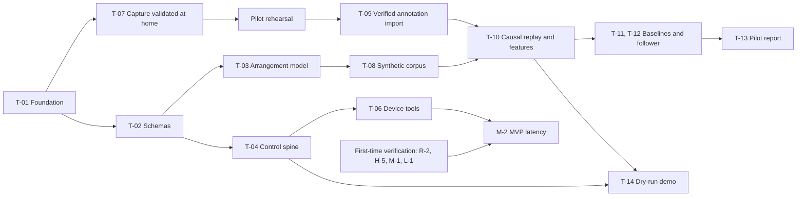

# Roobotto Implementation Plan

**Version 1.1 · 17 October 2026 · Owner: Randy Mitchell**

Source: [*Conceiving the Roobotto Project*](../Conceiving_the_Roobotto_Project-2026-10-16.html), the LLM Council report of 16 October 2026. The chairman synthesis was written by claude-fable-latest, and all four peer reviewers ranked gpt-astra-latest first. This plan adopts the council's recommended strategy and turns it into milestones, work packages, and tasks sized for one agent session each. Section 2 lists where it adds to or departs from the report.

**Revision 1.1** resolves every finding in the [17 October audit](implementation-plan-audit.md), and Section 16 maps each finding to its change. The main additions are explicit contracts for:

- the footswitch control map, and the difference between stopping Roobotto and restoring today's rig
- which inputs can authorize a cue, and how cue identity survives rescheduling and restarts
- critical-cue authority, and replay determinism
- separate timing populations for M1
- a procedure for verifying a device command for the first time
- validating that capture channels stay aligned
- accounting in the experiment for how much help each method received

Task priorities are also corrected. Foundation work (T-01 to T-03) can start now; T-04 and T-05 implement the new contracts.

Claim status used throughout:

- **Documented**: stated in a vendor manual, README, or package metadata, but not yet tested on our rig.
- **Verified**: tested on our rig, with a bench log in `captures/`.
- **Assumed**: must be tested before anything depends on it.

---

## 1. Summary

**What we are building.** Roobotto is a local, open-source stage manager. It estimates where the band is in a song (song, section, bar, beat phase, tempo) from signals already on stage: audio feeds, the Helix's MIDI, and footswitches. It drives production cues through a cue engine that is deterministic and assigns each cue a risk tier. The cue engine is useful even with following switched off. Nothing that changes the guitar or vocal sound fires on a guess.

**The bet (from the council).** Position in the song structure is a hidden state, estimated on a bar grid from combined evidence. It is not a label to be recognized from audio. Tempo is tracked continuously with a phase-locked loop (PLL). Structure is tracked discretely with an arrangement graph that knows how long each section usually lasts. The cue policy acts when the plausible hypotheses agree on the *action*, even if they disagree on the section label. Machine learning (ML) supplies evidence; deterministic code makes every firing decision.

**Two tracks from day one.**

- **Product track.** A cue engine and Assisted Stage Manager the band can use at rehearsal in about six weeks. One press per section, cues land on the downbeat, and lighting changes inside sections run by bar count. A STOP switch halts Roobotto's output instantly, and an H4 routing preset restores today's rig even if the Mac fails.
- **Research track.** The decisive experiment. Record contrasting takes, then compare four methods offline, using only audio up to each moment, for each subset of sensors: a fixed timeline, bar counting, linear online dynamic time warping (DTW), and the bar-grid follower. The results decide how much autonomy each cue class earns and what sensing the product needs.

**End of week 2:**

- Decisions recorded.
- A safe control spine with invariant tests.
- A validated recorder.
- One song recorded in four contrasting takes and annotated.
- A replay harness and the first results table.
- Measured latency for at least one device.
- A dry-run demo of a replayed take driving MVP scenes on predicted downbeats.

It is deliberately not a live autonomous system.

**Progress is gated by evidence, not dates.** Every milestone has exit criteria, and autonomy is earned separately for each cue class. The schedule is a capacity risk, not a commitment: weekly hours and the real effort of capture and annotation are not yet known (Section 7, risk R12).

---

## 2. What this plan adds to the council report

The council worked without web access or access to the rig, and tagged many items [verify]. I checked the ones that change build decisions; sources are in Appendix C.

1. **The Helix can report what the performer did.** Helix Stadium sends CC69 when a snapshot changes, if *Global Settings > MIDI > Send Snapshot CC* is on. It sends a Program Change when a preset changes from the hardware. Both go out over 5-pin and USB-C. That makes snapshot presses and preset (song) changes cheap, reliable observations, and free labels at every rehearsal. Only the snapshot changes a song file maps as section advances count as performer intent (Section 5.4). In M1, song identity comes from the Helix preset change plus the setlist, not from audio.
2. **The Helix is the first capture interface.** USB Out 7 and 8 are documented as dry DI sends with selectable sources such as Instrument 1 and Mic. So dry guitar and dry vocal reach the Mac over the existing USB-C cable. Drums, bass, and the room still need a second interface or a mixer with multitrack USB.
3. **Channel collision hazard.** Besides its global channel (1), Helix Stadium listens for block bypass and control on channel 2. Per the manual, it also listens for Matrix Mixer CCs on channels 3, 4, and 5 (the 1/4", XLR, and Phones layers). For example, CC57 at a value of 64 or more toggles mute for all paths on a layer. Our rig uses channel 2 for the MicroFreak and channel 3 for the MVP. A CC on those channels that reaches the Helix could mute an output layer or toggle a block. The plan adds a channel collision audit (bench test H-5). It also adds a rule that the output supervisor checks every device that will receive a message, not just the intended one (invariant I-13).
4. **The 4Cast MVP is triggered by MIDI notes.** Its lighting and video cues are mapped to MIDI notes, and a repeated note may restart a cue or a video. Until bench tests show otherwise, MVP cues are treated as one-shot events, not as state that is safe to resend.
5. **A known-good fallback already exists.** The H4MIDI WC stores four routing presets that switch without a computer (a vendor claim). Preset A is today's routing, in which the Helix coordinates the other devices. Preset B puts Roobotto in the loop. Switching to preset A restores the rig the band already trusts, even with the Mac off. That is a different operation from Roobotto's STOP switch, which only stops Roobotto's own output (Section 5.2).
6. **Dependency constraints.** Current numpy (2.5), scipy (1.18), and librosa (1.0) require Python 3.12 or newer. Matchmaker 0.3.0 requires Python older than 3.13 and numpy older than 2. BeatNet pins numba 0.54.1. madmom's PyPI release predates Python 3.10, and its models are licensed CC BY-NC-SA. The plan responds in four ways:
   - The core is pinned to Python 3.12.
   - Research libraries live in separate environments.
   - Online DTW is implemented in the core, with Matchmaker's Apache-2.0 code as a reference.
   - M1's live beat tracker is our own onset and PLL tracker, free of license restrictions, and is benchmarked against madmom and BeatNet rather than depending on them.
7. **Matchmaker is a score follower.** It aligns live audio to a score synthesized from MusicXML, and was evaluated only on solo piano. Its online time-warping implementations are useful references, but its pipeline cannot be used as our baseline unchanged.
8. **Take counts corrected.** The report asks for "≥5 takes" per song but lists 3 normal, 2 deviations, and 1 at an off tempo, which is 6. This plan uses 6 per song (24–36 in total). Its session split puts every song in the held-out session (Section 9).
9. **Clock drift handled.** Two USB audio devices run on independent clocks, and a 50 ppm mismatch is 12 ms over a 4-minute take. A sync burst (a click recorded on every channel plus a logged MIDI note) goes at the start *and* the end of every take. Before the first rehearsal, a 10-minute bench test with regular markers checks that the channels stay aligned all the way through, not just at the ends (Section 9).
10. **The agent can test before recordings exist.** A synthetic arrangement renderer makes drums, bass, and chords from a song YAML, with tempo drift and scripted deviations. It gives exact ground truth for regression tests and a copyright-free start on a public benchmark. Synthetic results never count as evidence that following is feasible.
11. **M1 made concrete.**
    - M1 needs one feed with strong rhythm (a drum or room mic) to predict downbeats.
    - The GO timing policy separates cues that land on the downbeat from GOs that arrive late, after the send deadline, or with no phase lock. Each group is reported separately (Section 8).
    - At first the Helix player keeps pressing the Helix's own snapshot switches. Only the transitions a song file maps as section advances count as GO.
    - The Helix player also sings lead, so taking press timing off him is the first win.
12. **No custom annotation UI.** Annotate with label tracks in Audacity or Sonic Visualiser; Roobotto imports and validates them.
13. **Confirming lighting changes.** The MVP sends its lighting data out as Art-Net. If that output is visible on the network, Roobotto can observe it passively. That lets it measure latency and confirm scene changes, instead of only reporting that a command was attempted.
14. **Antigravity setup.** Antigravity reads `AGENTS.md` at the repo root and `.agents/rules/*.md`, and truncates rule files over 24,000 bytes. Appendix A is a compact `AGENTS.md`. Appendix B breaks Phase 0 into bounded task cards.

Everything else follows the council: architecture, decision theory, gates, adversarial tests, and roadmap. Section 16 lists what revision 1.1 changed in response to the audit.

---

## 3. Decisions to lock in during week 1

Record each one as an architecture decision record (ADR) in `docs/adr/`. Recommended defaults are below; Randy approves them. ADR-010 to 014 are the contracts added in revision 1.1.

| ADR | Decision | Recommendation | Why |
|---|---|---|---|
| 001 | License | Apache-2.0 for Roobotto's own code | The council's recommendation, and it includes a patent grant. GPL tools (BTrack, aubio, Chordino) are used only as separate processes or as optional extras. Avoid Essentia (AGPL). |
| 002 | Runtime | Python 3.12, managed with uv. CI runs on macOS and Linux. | Current numpy, scipy, and librosa need 3.12 or newer; Matchmaker needs older than 3.13. Port hot paths to Rust or C++ only if measurements demand it. |
| 003 | Environments | `core` for runtime and evaluation. An `offline` extra (Beat This! and PyTorch) for reference beat grids. `research-a` (Matchmaker, numpy older than 2) and `research-b` (madmom from git plus BeatNet, Python 3.9) as separate tools that exchange plain CSV or JSON files with the core. Each research environment gets at most half a day of setup. | Keeps non-commercial models and old version pins out of the product. numba 0.54.1, which BeatNet pins, supports Python 3.7–3.9 and lists Apple Silicon support as unofficial. So `research-b` may need an Intel Python under Rosetta or a Linux machine. If a comparison is deferred, name the validation lost and carry its check to the milestone that needs it: the beat-tracker comparison to M1, the DTW cross-check to the full study. A deferred check is never reported as satisfied. |
| 004 | Config format | YAML written by people, validated by pydantic models, with JSON Schema exported to `schemas/` | Easy to read and edit. The schemas are the contract between components. |
| 005 | Units and time base | Song lengths (sections, bars) are in bars and beats. Physical intervals (device latency, debounce, gesture thresholds, timeouts) are in explicit time units: milliseconds in config, nanoseconds at runtime. All runtime time comes from the clock interface in ADR-014: `time.monotonic_ns()` live, a simulated clock in replay. Audio blocks are mapped from PortAudio's input time to that clock. | One clock, and every quantity in the right kind of unit. |
| 006 | Process model | The tracker and the cue engine run as separate processes. The tracker publishes `MusicalState` as localhost UDP datagrams (JSON or msgpack), each carrying a tracker session id and a sequence number. The engine rejects packets from an old session or out of order; only the newest matters. A stale stream or a new tracker session suspends tracker authority and drops the engine to MANUAL. Only the operator can re-enable it. | A tracker crash can't take down manual control. A lossy transport is fine when only the latest value matters. Reconnecting never silently restores authority. The same schema later becomes the public OSC/WebSocket state protocol. |
| 007 | MIDI channel numbering | Channels are 1–16 in config and logs, converted to 0–15 in exactly one adapter function | Removes a classic off-by-one error. |
| 008 | Data policy | Audio never goes in git. Rehearsal audio goes in `recordings/` and bench captures in `captures/`, both ignored by git. `corpus/` holds take manifests and annotations and is committed. Private show data goes in `local/`, which is ignored; a separate private repo cloned there is recommended. Lyric anchors live only in `local/`. Demo evidence is a text transcript from a synthetic or non-private replay. | Matches the README and `.gitignore`, and keeps copyrighted text and recordings private. |
| 009 | Output safety | Physical outputs are off by default. Arming is explicit for each run and never carries over a restart. The runtime has no override for unverified commands; Randy verifies each command for the first time outside Roobotto (Section 10.2). | Council principle 3 ("Reliability over cleverness"). Audit finding F-11. |
| 010 | Control map and gesture commitment | GO has its own single-purpose switch. BACK (tap) and MANUAL (hold) share a switch that never issues GO. STOP has its own switch and acts the instant it is pressed. RESTORE is the H4's preset A. RESUME is a deliberate HUD action. (Section 5.3) | A gesture can never issue a forward cue before it is recognized (F-1). Stopping Roobotto and restoring today's rig are different operations (F-6). |
| 011 | Input authority and provenance | Only performer-intent events authorize GO, BACK, or critical cues, with one authoritative path per source. Mapped Helix snapshot transitions count as GO. These never do: the snapshot a preset recalls on load, recalls made by automation, echoes of Roobotto's own output, duplicates, and anything of unknown origin. Authorization is tied to one specific cue occurrence. (Section 5.4) | A snapshot observation is not automatically a GO or an authorization (F-8). |
| 012 | Cue occurrence identity | A cue occurrence is identified by (performance, song instance, section visit, cue id). The scheduler generation only invalidates pending work. A persisted fired ledger makes each one-shot fire at most once across cancels, relocalization, reconnects, and restarts. (Section 5.5) | Cue identity has to survive scheduler generation changes (F-7). |
| 013 | Critical-cue authority | Tracker evidence alone never fires a critical cue, in any mode or at any milestone. Relaxing that for a specific cue takes its own ADR, citing held-out and gig evidence. A milestone, a config flag, or a fresh tracker packet cannot grant it. | The invariant must not appear to expire at M5 (F-9). |
| 014 | Determinism and replay | The engine core is a step function with an injected clock. The engine records the input trace it actually consumed. Decisions are hashed in a normalized form. (Section 4.1) | Deterministic replay needs a defined input, clock, and recording contract (F-2). |

---

## 4. Architecture at a glance

```
 Audio feeds                                    MIDI inputs
 (drums/room · bass · Helix USB 7/8 dry DI)     (Helix PC + CC69 · footswitches · KeyLab)
        │ sounddevice, timestamped blocks              │ mido/rtmidi, timestamped
        ▼                                              ▼
 Causal feature extractors                       Event adapters
 onset envelope · beat-synchronous chroma ·      (classify each message: performer intent,
 drum pattern · vocal activity · input health     state observation, or output echo;
                                                  interpret it through a verified capability record)
        └──────────────────────┬───────────────────────┘
                               ▼
  TRACKER process
    tempo PLL + bar-grid filter over (song, section visit, bar, tempo) + mode
    duration model · relocalization
    → publishes MusicalState at 50–100 Hz (session id + sequence number; newest wins)
                               ▼
  CUE ENGINE process (deterministic core, injected clock)
    transition forecast → decision gate (pure function) → scheduler
    (prepare / schedule / commit / cancel) → output supervisor
    (arming · ownership · generations · fired ledger · deadlines · rate limits ·
     check of every device that will receive the message)
    → adapters: mock · MIDI · OSC · Art-Net (observe only, at first)
                               ▼
  RECORDER: audio, observations, posteriors, the engine's consumed input trace,
            decisions, output attempts

  Essential guitar and vocal audio never passes through Roobotto.
  Watchdog: a stale MusicalState stream or a new tracker session → MANUAL.
```

The arrangement YAML is the central artifact. It is the contract between authoring, the tracker, and the cue engine. Section D of the council report has the schema example; T-02 turns it into schema v0. Cues are intents (`mvp.scene: chorus`, `guitar.snapshot: lead`), and exactly one tested adapter layer translates each intent into bytes.

| Message | Producer → consumer | Essentials |
|---|---|---|
| `Event` | adapters → engine, recorder | id; time it became available; source device and path; kind; payload; provenance (performer intent, state observation, output echo, or unknown); the action it maps to, if any |
| `MusicalState` | tracker → engine, HUD, recorder | tracker session id and sequence number; time it is valid for; song and its probability; mode; top hypotheses (section, visit, bar, probability); beat phase; tempo ± sd; next downbeat ± sd; boundary forecast (time ± sd, probability of each next section); input health |
| `CueOccurrence` | engine | occurrence id (performance, song instance, section visit, cue id); scheduler generation (invalidates pending work only, never part of the identity); class; intent; due time and send deadline; lifecycle state; the performer action that authorized it (critical cues) |
| `Decision` | gate → scheduler, recorder | fire, hold, ask, or abstain; the reason; the evidence used; GO timing class (Section 8), where relevant |
| `OutputAttempt` | supervisor → recorder, fired ledger | occurrence id; generation; device; command; bytes sent; send time; config hash; whether outputs were armed; result (attempted, confirmed, failed, or unknown) |
| Fired ledger record | supervisor (persisted) | occurrence id → first attempt time and result. Append-only, written to disk before the send, and loaded at startup. |

```yaml
# MusicalState example (tracker → cue engine)
tracker_session: 7f3c2a9e         # new id on every tracker start
seq: 18231
t_ns: 912345678901234             # time the estimate is valid for (engine clock)
song: {id: song_07, p: 0.999}
mode: following                   # following | lost | manual
hypotheses:
  - {section: chorus1, visit: 1, bar: 7, p: 0.93}
  - {section: chorus2, visit: 1, bar: 7, p: 0.05}
beat: {phase: 0.62, tempo_bpm: 127.4, tempo_sd: 0.9}
next_downbeat: {t_ns: 912346090000000, sd_ms: 12}
boundary: {t_ns: 912347965000000, sd_ms: 35, successors: {verse2: 0.81, bridge: 0.19}}
health: {drums: ok, room: ok, vocal: ok, midi: ok}
```

### 4.1 Engine determinism and replay contract (ADR-014)

- **Pure core.** The engine's decision logic is a pure step function: `step(state, input) → (state, decisions)`. It reads time only from an injected clock, and uses randomness only from a recorded seed.
- **Wrapper.** The process wrapper owns UDP, MIDI ports, and timers. It turns each one into an input, including timer ticks.
- **Recorded trace.** The wrapper records the *consumed input trace*: every input in the order the engine received it, with the time it became available.
- **What reproducibility covers.** The claim covers the consumed trace, the configuration (by hash), and the seed. Given those three, replay must produce identical normalized decisions.
- **Normalized decision hash.** Decisions are serialized canonically, with times relative to the start of the trace. The hash excludes run ids, absolute clock origins, and physical delivery measurements, which are reported separately.
- **Tracker identity.** Every packet carries `(tracker_session, seq)`. The engine drops lower sequence numbers and any packet from an earlier session. A new session means the tracker restarted, so tracker authority is suspended until the operator re-enables it.
- **Tests.**
  - Replaying recorded traces that include loss, reordering, simultaneous manual input, staleness, and a tracker restart yields identical normalized decisions.
  - The UDP wrapper is tested separately.
  - Real-time deadlines are measured separately, on the Mac.

**Where ML is allowed:**

- beat and onset activations
- per-bar observation likelihoods and learned sensor reliabilities
- anticipation features (fills, pickups)
- spotting known lyric keywords on the vocal feed
- offline alignment and structure proposals

Everything that schedules or fires a cue is deterministic.

---

## 5. Safety model and invariants

### 5.1 Cue classes and authority

| Class | Examples | Default authority |
|---|---|---|
| Decorative | Lighting looks inside a section, video variations | Counted in bars from the latest authorized GO (M1); fired by the tracker from M4 on; holds the current look when uncertain |
| Standard | Scene changes at section boundaries, synth layers | Fired on an authorized GO (M1); fired by the tracker with gating from M5 on |
| Critical | Helix snapshots, vocal effects, anything the audience would hear as a mistake | Fired only on a performer action that authorizes that specific occurrence (Section 5.4). Tracker evidence alone never fires a critical cue, in any mode or at any milestone. Relaxing that for a particular cue takes its own ADR (ADR-013). |
| Excluded | Hazardous effects | Never automated; independent interlocks |

**Deciding by expected cost.** For a fire-or-hold choice, fire when the posterior exceeds C_FP / (C_FP + C_FN), where C_FP is the cost of a wrong cue and C_FN the cost of a late or missed one. That gives about 0.95 for a guitar snapshot, about 0.8 for a synth layer, and about 0.33 for decorative lighting. A posterior is not a safety certificate. Critical cues also require all of these:

- the performer action that authorizes that specific occurrence (Section 5.4)
- agreement among the plausible hypotheses
- a minimum duration of evidence
- a cue-specific activation window
- calibration on held-out takes

"Refused to act" is a first-class outcome: it is logged and shown on the HUD.

### 5.2 Modes, STOP, and RESTORE

**Roobotto's modes:**

- **AUTO** is reserved. It differs from ASSISTED only for cues that an ADR-013 decision has granted autonomous authority. No cue has that today, so AUTO behaves exactly like ASSISTED.
- **ASSISTED.** Decorative and standard cues fire from the tracker within their gates (from M4 and M5). Critical cues still need their authorizing performer action.
- **MANUAL.** Cues fire only on an authorized GO or BACK. Decorative cues inside a section still run by bar count from the latest GO. The tracker can display its estimate but not fire. M1 runs in MANUAL.
- **STOP.** Roobotto cancels all pending work by starting a new generation, and sends nothing further. Routing is unchanged.

**RESTORE** is a routing action outside Roobotto: switch the H4 to preset A with its own button. Today's routing comes back, the Helix drives the devices again, and it works with the Mac off. Don't assume the H4 can be switched any other way until bench test R-1 proves it.

**Operator rules (these go on the printed operator card):**

- **STOP alone leaves the devices with no cue source** while the H4 is in preset B. Nobody sends lighting or synth cues until RESTORE or RESUME.
- **To fall back to today's rig,** press STOP, then RESTORE. If the Mac has failed, RESTORE alone is enough.
- **RESUME** is a deliberate HUD action, never a footswitch. First put the H4 back on preset B, then RESUME. Resuming does the following:
  - starts a new generation
  - releases no pending or stale cue
  - treats every device's state as unknown
  - sends nothing until the next authorized GO, which sends the target section's entry state as new occurrences
  - keeps tracker authority suspended until the operator re-enables it
- **Each device has exactly one owner at a time:** the Helix in preset A, or Roobotto in preset B. Roobotto can't yet detect which H4 preset is active, so the HUD asks the operator to confirm preset B before RESUME. This stays until R-1 finds a way to detect it.

### 5.3 Control map and gesture commitment (ADR-010)

| Control | Gesture | Action | Authorized at | From |
|---|---|---|---|---|
| GO switch | press | Advance to the next section | the press edge; the GO timing policy (Section 8) sets the send time | M1 |
| BACK / MANUAL switch | tap (released before 500 ms) | **BACK**: go back to the previous section. Cancels any GO whose send deadline hasn't passed. If that GO's commands were already sent, BACK re-enters the previous section and sends its entry state as new occurrences. | on release | M1 |
| BACK / MANUAL switch | hold (500 ms) | **MANUAL**: toggle tracker authority off or on | when the hold reaches 500 ms | M3 (logged with no effect before then) |
| STOP switch | press | Stop all Roobotto output and cancel pending work | the press edge, immediately | M1 |
| EXTEND switch | press | Extend the current section, or exit a loop | the press edge | M4 |
| H4 preset A | the H4's own button | **RESTORE** today's routing | when the H4 switches (R-1 verifies) | M1 |
| HUD | keyboard | RESUME, arm or disarm, re-enable tracker authority | deliberate operator action | M1 |

**Rules:**

- GO is never inferred from a switch with more than one gesture. BACK and MANUAL never issue GO.
- STOP acts on the press edge. It is never a long press.
- Nothing irreversible is scheduled before the action's authorization point.
- A command that has already been sent is committed. BACK cannot cancel it just because its audible or visible effect is still pending; it restores the previous state as new occurrences instead.
- **Recognition delay.** BACK is recognized when the switch is released, so its delay is the length of the tap. MANUAL is recognized at 500 ms. Neither is quantized, so neither delay affects downbeat timing.
- **Stage 1 of M1.** A Helix snapshot change that the song file maps as a section advance is also a GO (Section 5.4).
- **Validation.** The control map lives in the rig config. Validation rejects any map that puts a forward action and a backward or safety action on the same switch.

### 5.4 Input authority and provenance (ADR-011)

- **Every input event is tagged** with the path it arrived on and its provenance: performer intent, state observation, output echo, or unknown.
- **One authoritative path per source.** Helix events are taken from the Helix's USB-C connection, and in preset B the H4 does not also route Helix messages to the Mac. If two paths can't be avoided, events are merged into one, and H-1 proves it works.
- **Performer intent comes from only two places:**
  - Roobotto's own switches.
  - Helix snapshot transitions that the song file maps as section advances, for example `advance_on: {snapshot: 3}` on a section boundary.
- **These are never performer intent:**
  - snapshot changes the song file doesn't map
  - the snapshot a preset recalls when it loads, meaning any snapshot CC within the initialization window after a Program Change (default 500 ms, set from H-2)
  - recalls made by Showcase or Command Center automation
  - a CC69 that matches a value Roobotto sent within the echo window (default 250 ms, set from H-1)
  - duplicates
  - anything whose provenance can't be established; the rule fails closed

  These events update Roobotto's copy of device state and serve as tracker evidence only.
- **Authorization is tied to one occurrence.** A performer action authorizes either the occurrences its section advance creates, or the single critical proposal that was armed and shown on the HUD when the action happened. A press made before a proposal was armed cannot authorize it, and one press never authorizes a different critical action.

### 5.5 Cue identity and the fired ledger (ADR-012)

- **Occurrence id** = (performance, song instance, section visit, cue id). A new visit creates new occurrences, for example when the band repeats a chorus or BACK re-enters a section. Relocalizing within the same visit does not.
- **Generation** increments on cancel, reschedule, STOP, RESUME, and relocalization. It invalidates pending work and is never part of the identity.
- **Fired ledger.** Before sending a one-shot, the supervisor appends an "attempting" record for its occurrence and flushes it to disk; then it sends, and records the result. Any record, whether attempted, confirmed, failed, or unknown, blocks a second send of that one-shot. If the process dies between the record and the send, the cue is lost rather than duplicated: at most once.
- **Retryable state,** meaning a scene or patch that the bench showed is safe to resend, can be resent only by an explicit resync action. It is never resent automatically after a restart or reconnect.
- **Restart** comes up unarmed, loads the ledger, and turns no past cue into new work. The next authorized GO starts new occurrences.

### 5.6 Invariants

Each invariant has a named test in `tests/property/test_invariants.py`. Weakening one requires an ADR.

| ID | Invariant |
|---|---|
| I-1 | An unknown or unverified mapping cannot reach a physical output; it can reach the mock adapter only. The runtime has no override. |
| I-2 | No physical output while unarmed. Arming never carries over a restart. |
| I-3 | A manual action on a device Roobotto owns cancels pending automation for that device. |
| I-4 | Expired cues are discarded and never fired outside their `on_miss` window. |
| I-5 | A restart or reconnect never resends a one-shot that is already in the fired ledger, including attempts whose outcome is unknown. A restart turns no past cue into new work. |
| I-6 | Cue identity is the occurrence. The scheduler generation is never part of it. A genuinely new section visit creates new occurrences. |
| I-7 | At most one output per occurrence, through cancels, rescheduling, relocalization within the same visit, and reconnects. |
| I-8 | A lost or stale input can never increase authority. A new tracker session or a reconnect never restores authority silently. |
| I-9 | During replay, no component can read audio after "now"; a guard raises if it tries. |
| I-10 | MIDI channel numbers are converted in exactly one adapter function. |
| I-11 | Every physical output attempt is logged with its reason, occurrence, config hash, timing, and result. |
| I-12 | A manual change made directly on a device updates Roobotto's copy of that device's state and wins. Automation never fights the performer. |
| I-13 | A message is never sent on a port and channel where any listening device's response is unknown or unsafe. The supervisor checks every device that will receive it, using the rig routing graph. |
| I-14 | Tracker evidence alone never fires a critical cue, in any mode or at any milestone. Each critical occurrence needs a performer action that authorizes it. A milestone, config flag, mode change, or fresh tracker packet cannot grant that authority; only a per-cue ADR backed by evidence can (ADR-013). |
| I-15 | Per-device rate limits are enforced. Retryable state (scene, patch) is kept separate from one-shot events (note, sample). |
| I-16 | Only performer-intent events can authorize GO, BACK, or critical cues. State observations, output echoes, recalls at preset load, automated recalls, duplicates from a second path, and events of unknown provenance never do. |
| I-17 | No switch combines a forward action with a backward or safety action. BACK and MANUAL never issue GO. STOP acts on the press edge. |
| I-18 | STOP cancels all pending work and sends nothing further. RESUME requires a deliberate operator action, starts a new generation, releases no stale cue, and never creates two owners for a device. |
| I-19 | The same consumed input trace, configuration, and seed always produce the same normalized decision hash. |

---

## 6. Roadmap and gates

The timing assumes part-time development with the coding agent and one rehearsal a week. Turn weeks into dates only after weekly hours and the measured effort of capture and annotation are known (R12). The gates, not the weeks, decide when a milestone is done.

| Milestone | Useful result | Exit criteria | Indicative timing |
|---|---|---|---|
| **M0** Rig audit and safe control spine | Verified command inventory; mock devices standing in for the real ones; measured device latencies; channel collision audit | No dependency on essential audio; every enabled command passed first-time verification; MIDI feedback loops and channel collisions ruled out | Weeks 1–2 |
| **M1** Assisted Stage Manager | One press advances a section; each section's set of cues lands on the predicted downbeat; decorative cues run by bar count; STOP and RESTORE work | Full rehearsal set configured. At least 95% of phase-locked quantized cues land within ±80 ms of the annotated downbeat; the other GO timing classes are reported separately with counts (Section 8). Zero unwanted critical cues across all modes and fallback cases. STOP, RESTORE with the Mac off, and RESUME all exercised at rehearsal. Every rehearsal replayable. | Weeks 3–6 (M1a: 3–5 songs by week 4) |
| **M2** Decisive experiment | Results table and a go/no-go memo in the repo | Section 9 gates evaluated on the held-out session, with assistance accounting; decision recorded as an ADR | Pilot in weeks 1–2; full study in weeks 3–8 (three rehearsals) |
| **M3** Shadow follower | Live estimate of position and proposed cues on the HUD at rehearsal; fires nothing | Three rehearsals with ≥95% beat-level agreement with performer presses; disagreements reviewed and turned into labeled takes | Weeks 9–12 |
| **M4** Autonomous decorative production | Lighting and video follow selected songs on their own | Important scenes 95% within ±150 ms at the fixture; decorative coverage ≥95%; low confidence holds the current look; disconnect and overload tests pass | Weeks 13–18 |
| **M5** Graduated authority | Standard cues autonomous with gating; critical cues stay performer-authorized (ASSISTED), as I-14 requires at every milestone | Two gigs in ASSISTED; zero unexpected critical cues; tracker-only critical requests refused and logged in every mode; cues wrongly refused under 5% of the time; end-to-end latency measured at each device | Months 5–6 |
| **M6** Structural deviation and performer intent | Learned transition graphs, extended and repeated sections, recovery after getting lost, drum triggers, pickup features | Deviation takes recovered within 2 bars; ≥80% of solo extensions followed without a press | Months 6–9 |
| **M7** Appliance and portability | Raspberry Pi 5 or mini-PC build; iPad HUD over OSC/WebSocket; setup wizard | A second band with a different rig sets up three songs in under an hour from the docs | Months 9–12 |
| **M8** Community product | Plugin API for device adapters; shareable arrangement models (structure and cues, no audio); benchmark harness; governance | An outside contributor adds an adapter without touching the core; three or more bands with public models | After month 12 |

Target the Pi only after measurements show which features matter and how much headroom there is. Build the iPad version as its own project.

**After M2, the council's decision rules pick the branch.** Every conclusion states what assistance it relied on (Section 9):

- **Confirm, audio only.** B4 meets the gates and clearly beats bar counting (B1) and linear DTW (B2). Proceed to M3. B3 (room mic only) shows whether a lighter tier is viable. If B3 fails, isolated feeds become mandatory for autonomous cues, so plan the stage I/O (a splitter or mixer sends) before M3.
- **Confirm with existing MIDI.** Only B5 meets the gates, so success depends on the presses the performers already make. Proceed to M3 with ASSISTED as the default, and describe the result as following with existing MIDI, not as audio-only following.
- **Partial: needs extra presses.** Only B6 meets the gates. ASSISTED becomes the product's default. The follower drives decorative cues, quantization, and recovery.
- **Refute.** M1 is the product: polish quantization, authoring, and the HUD. The follower continues as a research track, using the council's Architecture 3 sensors.

---

## 7. Phase 0: the first two weeks

"Days" means working sessions. If the calendar slips, keep the order. Only the pilot recording is tied to a date, the next available rehearsal, so book it now and plan backward from it.

**Capacity.** Phase 0 is ambitious. It depends on a working capture setup, a rehearsal, manual annotation, and several software components, and weekly hours are still unknown. Track hours per work package in week 1 and measure the actual capture and annotation effort before turning working sessions into calendar dates. If the work doesn't fit, use the reductions below. Never cut safety or physical-output prerequisites.

| Work package | Days | Owner | Tasks | Output | Exit check |
|---|---|---|---|---|---|
| WP0 Foundation and decisions | 1–2 | Agent; Randy approves | T-01 | Repo, CI, `.gitignore` additions, ADR-001 to 014, `AGENTS.md`, doc stubs | CI passes on macOS and Linux; ADRs accepted |
| WP1 Schemas and arrangement model | 2–3 | Agent | T-02, T-03 | Pydantic models, JSON Schemas, validator, bar-grid expansion, production-equivalent classes | Configs that must be rejected are; examples validate |
| WP2 Control spine | 3–5 | Agent | T-04 | Deterministic engine core, trace recorder, provenance classification, fired ledger, scheduler, supervisor, STOP/RESUME, mock adapter, MIDI adapter (off by default) | Invariant, audit-scenario, and trace-replay tests pass |
| WP3 Bench verification | 3–6 | Randy: external tools first, then the T-06 tools | T-06; Section 10.2 | Hardware worksheet; today's routing documented; MVP mapping and latency; channel audit | First-time verification followed; no enabled mapping without a bench log |
| WP4 Recorder and capture rig | 4–5 | Agent builds; Randy tests at home | T-07 | `roobotto record`, manifests, per-block metadata, sync bursts, alignment validator | 10-minute marker test passes; an injected discontinuity is detected |
| WP5 Pilot recording and annotation | 5–7 | Band records; Randy annotates | T-09 (P0 part) | 4 takes, manifests, verified annotations | A fresh checkout plus local audio replays the pilot |
| WP6 Replay, baselines, follower | 6–9 | Agent | T-08, T-10, T-11, T-12 | Synthetic corpus, replay harness, features, baselines, bar-grid follower v0, proposed cues (nothing fires) | Future-read guard test passes; synthetic expectations met |
| WP7 Results and demo | 9–10, with buffer to day 14 | Agent; Randy reviews | T-13, T-14 (T-15 if time) | Benchmark command, pilot report, dry-run transcript, recommendation | Day-14 definition of done |

**Dependencies.** The main paths are below; not every task is sequential, and they are not equal in size.



The critical path, in text: capture validated at home (T-07) → pilot rehearsal → annotation → replay on the real takes → pilot report. WP6 starts on the synthetic corpus, so it doesn't wait for the rehearsal.

**Reductions that still preserve the gates.** These are the only cuts allowed; each keeps a safeguard.

| Item | Allowed reduction | Safeguard that stays |
|---|---|---|
| Passive Art-Net observer (T-06, P1 part) | Defer it if the light-sensor or video method is practical | A latency distribution of at least 100 sends, a calibrated timing reference (its own error measured), and fixture response counted separately |
| Synthetic renderer (T-08) | Simple deterministic pulses, tones, and chord changes; no acoustic realism | Separate feeds, exact annotations, tempo changes, repeats and skips, causal twins, dropouts on individual streams |
| Annotation propagation (T-09, P1 part) | Optional | Import, validation, and a person checking every evaluation boundary; no assumed annotation time |
| Extra feature families (T-10, P1 part) | Start with onset and chroma only | Input health and missing-feed handling. The report lists the reduced feature set and the deferred ablations. |
| Bench worksheet | Run only the tests the enabled commands and actual wiring need (Section 10.2) | Before physical MVP output: the Mac's route, recipient safety, the mapping verified, and the loop check. If preset B is used, also the inventory of routes it replaces and preset-A recovery. |
| Other device tests | H-3, A-1, and K-1 wait until those outputs are enabled | H-1, H-2, P-1, and R-1 happen before M1 use. A mock-only demo doesn't complete M-2. |
| Research environments | Defer a comparison when the half-day cap is reached | Name the validation lost and carry its check to the milestone that needs it (ADR-003) |

**Scope rules:**

- A reduced matrix of methods, features, or ablations is reported as reduced scope in the pilot report. It does not count as meeting the unchanged gate.
- Safety and physical-output prerequisites never move to make a date.

**Day-14 definition of done:**

1. The repo builds in CI. ADR-001 to 014 are accepted, and `AGENTS.md` is in place.
2. `docs/evidence-register.md` and `docs/hardware-verification.md` exist and are filled in so far. Every enabled mapping went through first-time verification and has a bench log; expect the MVP scenes only.
3. The control spine passes its invariant, fault-injection, audit-scenario, and trace-replay tests for everything built so far. The gesture tests for I-17 arrive with T-05, before M1.
4. Capture is validated. The 10-minute marker test shows ≤1 ms alignment throughout, or reports its measured error, and it detects an injected discontinuity.
5. The pilot is complete. Four takes are recorded with sync bursts at the start and end, and have manifests, per-block metadata, and human-verified annotations.
6. A results table compares B0, B1, and B3 (plus B2 if done) by feed subset, computed on the as-captured streams. It includes timing and coverage plots, failure examples, assistance accounting, and a reduced-scope section, and is labeled "pilot".
7. There is a measured latency distribution for MVP scene changes (n ≥ 100) with a calibrated timing reference, with fixture response counted separately. A mock-only setup does not satisfy this item.
8. The dry-run demo (T-14) has a committed text transcript from a synthetic take.
9. A one-page recommendation: continue, change sensing, or reduce autonomy.

**Not in Phase 0 (council):**

- custom neural networks
- recognizing arbitrary songs
- an iPad app or a Pi appliance
- direct control of lighting fixtures
- hazardous effects
- a live LLM agent
- any autonomous or Roobotto-sent change to the Helix

---

## 8. Phase 1: Assisted Stage Manager (M1)

**Goal.** At rehearsal:

- One authorized GO per section moves lights, video, and synth on the next downbeat.
- Decorative cues inside each section run by bar count.
- The Helix stays under the player's direct control.
- STOP halts Roobotto's output instantly, and RESTORE (H4 preset A) returns today's routing, even with the Mac off.

**Prerequisites:**

- M0 is complete.
- One feed with strong rhythm reaches the Mac: a drum mic, a room mic near the kit, or a drum mix from the mixer.
- The Mac's MIDI path into the rig is tested (R-2).
- Song selection (H-2), the switch assignments (P-1, matching ADR-010), and STOP/RESTORE/RESUME (R-1) are verified.
- T-05 (manual control) and T-15 (HUD) are done, even though they are optional for day 14.

**Live behavior:**

1. **Song selection.** The Helix's Program Change on preset recall (H-2) is mapped to the setlist. The snapshot that the preset recalls as it loads is never a GO (Section 5.4). The fallback is a "next song" action on the HUD.
2. **Beat and downbeat.** Our onset tracker runs on the drum feed, using only past audio. A PLL limits it to the song's tempo range and meter. Downbeats are anchored by authorized GO events and by the song start.
3. **GO timing.** Every GO is handled under the timing policy below.
4. **Stage 1 (M1a).** The Helix player presses Helix snapshots as today. Only the transitions the song file maps with `advance_on` count as GO for every cue except the Helix's. All other snapshot changes are state observations.
5. **Stage 2.** This is opt-in per song, after H-3. The GO switch goes to Roobotto, which sends CC69 on the downbeat. That is a critical cue, authorized by that specific GO. Any CC69 the Helix sends back is tagged as an output echo and can never authorize anything. If its provenance can't be established, it doesn't count.
6. **Bar counting.** Bars are counted on predicted downbeats from the latest authorized GO, to fire decorative cues inside a section. Every authorized GO resets the count.
7. **AUM session recall** happens only between songs, prepared during the last section or the gap, unless A-1 shows it is glitch-free.
8. **Flight recorder.** Every rehearsal is recorded: audio, MIDI, the consumed input trace, and decisions. That feeds M2 and M3, and normal run-throughs double as corpus takes.

**GO timing policy (audit F-10).** For each cue in a GO's set of cues:

> send deadline = predicted downbeat − measured device latency − margin (default 5 ms)

| Class | When | What happens | Gate | Reported |
|---|---|---|---|---|
| **Q** Quantized | Phase locked, and the GO is authorized before the send deadline | Sent so its effect lands on the predicted downbeat | At least 95% within ±80 ms of the annotated downbeat. Measured at the predicted effect time (send time plus measured device latency), and at the observed effect where it can be measured. | Median, p95, p99; count |
| **D** Deadline missed | Phase locked, and the GO is authorized after the send deadline but before the downbeat | The cue's `on_miss` policy applies (default: send now). Never deferred to the next bar. | Press-to-send ≤10 ms at p99 (target) | Lateness against the annotated downbeat; count |
| **L** Late window | The GO is authorized within the late window after a predicted downbeat (default ¼ bar, which is 500 ms at 120 BPM in 4/4) | Sent now | Press-to-send ≤10 ms at p99 (target) | Lateness; count |
| **F** No lock | No phase lock, or no downbeat predicted within one bar | Sent now, which is today's behavior | Press-to-send ≤10 ms at p99 (target) | Count; share of all GOs |

Every GO record keeps the press time, the send time, and the observed effect time where it can be measured. Every report gives the total GO count and each class's share. The ±80 ms gate applies to class Q only. The count of unwanted critical cues covers all four classes and every mode.

**Authoring.**

- Start with 3–5 songs (M1a), then the full set.
- For each song, write down: sections and bar counts, tempo range, cue intents per section, cue classes, and the `advance_on` snapshot mappings.
- The target is 20 minutes or less per song, but that is a hypothesis to test, not an estimate. Record the actual time, which feeds risk R5.
- `docs/authoring-guide.md` holds the template.

**Exit criteria.**

- Everything in the council's M1 row (Section 6).
- Scheduler jitter at the 99th percentile is 5 ms or less, measured on the Mac.

---

## 9. The decisive experiment

**Hypothesis (council).** For known songs with a lightly annotated arrangement graph, a causal bar-grid follower using inexpensive features and a few input feeds can do three things on held-out performances of The Modems' arrangements:

- track the part of the song that determines which cues apply
- predict enough boundaries to automate a substantial share of cues
- refuse rather than misfire when a high-consequence choice is ambiguous

It has two sub-hypotheses:

- Isolated feeds substantially widen the set of cues that can be safely automated, compared with a room mic.
- Tracking that knows the arrangement graph beats linear online DTW when the band deviates from the arrangement.

The experiment runs entirely offline. Recordings are replayed as if live, and each method sees only the audio up to that moment. No stage, MIDI hardware, or UI is needed, and a failed result does not invalidate the cue engine.

### Pilot (Phase 0)

- One song with built-in ambiguity, chosen from the 22. A good choice has verses that sound identical but carry different downstream cues, plus an extendable solo or repeatable chorus, plus a held vocal or variable ending.
- Four takes:
  - **T1** reference
  - **T2** natural variation
  - **T3** extended solo or doubled chorus
  - **T4** skipped section or held phrase

  T5, at an off tempo, is optional.
- The results are labeled "pilot". No held-out claims are made from them.

### Full study (weeks 3–8)

Choose 4–6 songs, each for a different failure mode:

- the identical-verse trap
- an extendable solo
- held vocal phrases or a variable ending
- weak or changing rhythm
- a free-tempo (rubato) intro
- a keys-heavy song

| Session | Takes per song | Use |
|---|---|---|
| S1 | 1 normal + 1 scripted deviation (A) | Development |
| S2 | 1 normal + 1 at an off tempo (about ±8%) | Development |
| S3 | 1 normal + 1 scripted deviation (B, a different type where possible) | **Held out** |

- That is 6 takes per song, 24–36 in total.
- Each session is 8–12 takes, or about 30–50 minutes of playing at roughly 4 minutes per take.
- Normal takes can come from regular run-throughs with the recorder on, so only one take per song per session needs dedicated time.
- **Deviations to choose from:**
  - extend the solo by 8 bars
  - double a chorus
  - skip a verse
  - drums drop out for 2 bars
  - stop and restart
- **S3 is held out entirely.** Freeze code, parameters, and thresholds before annotating it, and record the commit hash.
- Keep every channel of a take in the same split.
- Tempo robustness on held-out takes can also be tested by time-stretching S3 takes ±8%. Report that as a supplementary result, since stretching adds artifacts.

### Capture specification

- **Channels:**
  - room mic in the stage position
  - drum feed (close kick and snare mics, or an overhead)
  - bass DI
  - dry vocal (Helix USB 8)
  - dry guitar DI (Helix USB 7)
  - processed Helix output (USB 1/2), for reference
- **Format:** 48 kHz, 24-bit, with all MIDI ports logged.
- **Sync:** a burst (audio click plus logged MIDI note) at the start and end of every take, and a manifest for each take.
- **Per-block metadata,** recorded by T-07: device, sample index, ADC timestamp, callback time, and overflow or underflow flags. Also record the channel and clock configuration: Aggregate Device members, clock source, and drift-correction settings.
- **Validate the topology first.** Before the first rehearsal, run a 10-minute bench recording with a shared marker signal: a click split to every input at regular intervals. It must show alignment within 1 ms throughout, or report the measured error, and it must detect an injected discontinuity. Two end markers alone only estimate offset and average skew. Intervals the validator flags as invalid are excluded from analysis and reported.
- **Two versions of each take:**
  - **As-captured:** each stream as it was available at capture time, which is what the live system would have had. All reported follower results come from this version.
  - **Corrected:** drift-corrected using the sync bursts, for annotation and measurement only. A follower result computed on corrected streams is labeled "idealized" and needs a separate check against live capture.

  The end-of-take burst is used only for correction and measurement. It is not musical content, and no follower is scored on it.
- **Do not interrupt essential audio paths.** Check splitting, phantom power, and impedance.
- Make one extra recording at gig volume with the mic in its stage position, for risk R2.

### Ground truth

Annotate the following:

- section visits
- bar lines at boundaries
- beats near cue boundaries
- intended cue instants, defined precisely (the first chorus kick, the first new guitar attack, the vocal release)
- deviation points, and the first observable evidence of each
- ambiguous intervals, kept as intervals rather than forced to a point

Offline DTW from the reference take produces drafts. **A person checks every evaluation boundary.** Drafts are never ground truth, because propagation errors would contaminate the comparison of alignment methods. A second annotator (a bandmate) labels at least 20% of takes, and disagreements are kept as uncertainty. Record the actual annotation time; no figure is assumed.

### Methods

All methods are causal: they use only audio up to each moment.

| ID | Method |
|---|---|
| B0 | Fixed timeline from the annotated song start, at nominal tempo (what a click would give you) |
| B1 | Beat tracker plus pure bar counting, with no content observation |
| B2 | Linear online DTW (Dixon-style) against the reference take, room mic |
| B3 | Bar-grid follower, room mic only |
| B4 | Bar-grid follower, isolated feeds, audio only |
| B5 | B4 plus existing MIDI and controller events. These include the Helix player's snapshot presses, which may mark boundaries. |
| B6 | B5 plus a simulated performer press at 50% of boundaries, with ±1 beat jitter, on top of whatever existing MIDI already supplies |

- **Ablations:** with and without the duration prior; with and without the transition graph.
- **Human baseline:** human-operated cueing as a baseline for timing and workload, not treated as perfect.
- **No echoes.** Output-derived events (echoes of commands Roobotto sent) are excluded from every method's inputs and never count as independent corroboration.

**Leakage controls:**

- Only audio available by the simulated "now".
- No windows centered on the current moment.
- No normalization over the whole recording.
- Thresholds frozen before S3.
- Accelerated replay tests the logic, not real-time deadlines; those are measured separately.

### Metrics

- **Accuracy:** section and visit accuracy, and production-equivalent accuracy, per beat. A confusion matrix for Verse 1 against Verse 2. (Two positions are production-equivalent when their cues are the same.)
- **Boundary timing error:** median, 95th, and 99th percentile, signed, reported separately for predicted and unexpected boundaries.
- **Spurious transitions:** per song, at each threshold, especially those above the critical threshold.
- **Coverage against wrong cues:** cue coverage plotted against wrong-cue rate. A system that abstains on everything is not a success.
- **Recovery:** time in bars to recover after a deviation, and the share of time spent lost.
- **Tempo:** tempo error, and how often tempo is read at half or double.
- **Speed:** real-time factor on the Mac.
- **Assistance accounting (audit F-12):** for each method, how many boundaries it was told about, by which inputs (existing MIDI, simulated presses, or both, counting overlap), and when relative to each boundary. Conclusions keep the audio-only result (B4) visible. They describe B5 and B6 successes as success under that sensing and assistance condition.

### Adversarial tests (council)

- **Causal twins:** same start, different continuation. The system must abstain until they diverge; this also catches accidental future leakage.
- **Identical repeated sections** with different downstream cues.
- **Missing drums:** mute only the drum stream.
- **False landmark:** a chorus-style fill that stays in the verse.
- **Stale scheduler:** a predicted cue followed by a skip or override must never fire later.

### Gates (proposed targets, not current capability)

| Measure | Gate |
|---|---|
| Production-equivalent accuracy, normal held-out takes | ≥98% outside annotated ambiguous intervals (also report without excluding them) |
| Boundary timing, predicted boundaries | ≥95% within 1 beat; ≥80% within ±150 ms |
| Decorative cue coverage | ≥95% |
| Spurious transitions above the critical threshold | Zero across the corpus |
| Recovery after a clear deviation | Within 2–4 bars after a distinguishing landmark |
| Causal twins | Must abstain before the takes diverge |
| Processing | Sustained real time with substantial headroom |

**Statistical honesty (council).** A 99% chance of no unwanted critical cue in a 2-hour show means a rate below about 0.005 per hour. With zero errors observed in H hours, the one-sided 95% upper bound is about 3/H, so demonstrating that rate takes about 600 error-free hours. The study establishes feasibility, and rehearsals establish usefulness. Neither proves that rare errors won't happen. Early reliability comes from:

- restricted authority
- deterministic guards
- corroboration
- graceful abstention

---

## 10. Rig integration and bench verification

### 10.1 What the documentation says (status: Documented)

| Device | Documented capability | What it means for Roobotto |
|---|---|---|
| Helix Stadium XL | Receives CC69: values 0–7 select snapshots 1–8, 8 is next, 9 is previous. Presets and setlists are recalled with CC32 plus a Program Change. | Snapshot and preset control is possible once verified. |
| | Sends CC69 on snapshot change if *Send Snapshot CC* is on. Sends a Program Change when a preset changes from the hardware (*Send MIDI PC*). Both go out over 5-pin and USB-C. | Performer presses and song changes become observations. Whether a CC69 is also sent back when the Helix receives one, and on preset load, is unknown (H-1, H-2). |
| | Global channel 1; block bypass and control on channel 2; Matrix Mixer CCs on channels 3, 4, and 5 (CC57 toggles mute for a layer) | Collides with the MicroFreak (channel 2) and MVP (channel 3) unless routing filters it. |
| | Showcase is the built-in automation and playback engine. A song holds up to 8 audio tracks plus "flags" that set tempo and time signature. Songs can automate preset and snapshot recall and MIDI. Song and marker transport use CC63, CC10, and CC46–51. | Showcase is timeline-driven: time is the master clock. Roobotto can navigate it with CCs. Recalls made by Showcase are automation, never performer intent. |
| | Command Center: up to 16 "Instant" commands per preset, sent on preset recall; values can change per snapshot | This is probably today's cue architecture. Document it before replacing any of it (H-4). |
| | USB audio on macOS uses Core Audio with no driver, at 48 kHz/24-bit. USB 7 and 8 are dry DI sends with a selectable source. USB In 3/4 can feed the Input block for re-amping. | Dry guitar and vocal reach the Mac. Re-amping gives a test loop for snapshot latency that needs no extra hardware. |
| | MIDI clock send and receive | Later, Roobotto could send tempo to the Helix's delays, after a jitter test. |
| CME H4MIDI WC | 2 DIN in and 2 out. A USB-A host port for up to 8 devices through a hub. One USB-C port to a computer, with 4 virtual ports each way. Routing, merging, splitting, filtering, and mapping are set up in HxMIDI Tools. 4 presets switch without a computer. Bluetooth only with the optional WIDI Core. | RESTORE through preset A, and per-port filters to control collisions. Don't assume the presets can be switched remotely. There is only one computer port, so the Mac and iPad can't both use it. |
| 4Cast MVP | Plays video and DMX lighting cues recorded as Art-Net from lighting software. Cues are triggered by MIDI notes. USB-powered. (Secondary source.) | Cues are one-shot note events. Latency can be observed on Art-Net if it is broadcast. |
| AUM, MicroFreak, MIDI Captain, DMC.micro PRO | Not researched. Current mappings (AUM session recall on channel 15, MicroFreak on channel 2) come from the brief. | Bench-test before use. |

### 10.2 First-time verification and the bench worksheet

**First-time verification (ADR-009, audit F-11).** Each command's status moves through three states:

- **unknown**
- **documented:** a source is cited
- **bench_verified:** a bench log is cited

Only bench_verified commands can go into a physical profile, and Roobotto has no override. So the first verification of any command happens outside Roobotto, run by Randy:

1. **Isolate** the device under test: connect only the routes needed, keep the volume low, and keep the lights safe.
2. **Watch** every relevant port with an external monitor, such as [Snoize MIDI Monitor](https://www.snoize.com/MIDIMonitor/) (free, macOS).
3. **Send** candidate messages from an external source. That can be a controller you already own (the KeyLab can play notes on channel 3 for MVP scenes) or a command-line sender such as [SendMIDI](https://github.com/gbevin/SendMIDI).
4. **Record** what each message did, who else received it, and any side effects, in `captures/<date>-<device>/` and `docs/hardware-verification.md`.
5. **Mark** the command bench_verified with that log, then add it to the profile.

After that, Roobotto's own tools (`measure-latency`) can repeat the test at scale. Those tools refuse any command that isn't bench_verified.

**Which tests gate what:**

- **Physical MVP output through the show routing:** R-2, H-5, M-1, and L-1 first. If preset B is used, also H-4 (the inventory of routes it replaces) and R-1 (preset-A recovery).
- **A physically isolated bench setup** (the MVP wired straight to the Mac, nothing else connected) needs only M-1, M-2, and L-1.
- **M1 use:** H-1, H-2, P-1, and R-1.
- **When each output is enabled:** H-3 (Helix opt-in), A-1 (AUM), and K-1 (MicroFreak).

| ID | Test | Method | Pass |
|---|---|---|---|
| H-1 | Helix snapshot reports and echoes | Turn on *Send Snapshot CC*. Watch USB and the H4 path with an external monitor while you press each snapshot. Then send CC69 to the Helix and see whether it echoes a CC69 back. | CC69 values 0–7 arrive on the expected channel. The authoritative path is chosen. Echo behavior is documented and sets the echo window. No other device reacts. |
| H-2 | Helix song changes and preset load | Change presets from the footswitches, and by selecting a song in Showcase. Note any CC69 the preset sends as it loads. | A Program Change is seen for both, or the silent path is documented. Load-time snapshot messages are documented and set the initialization window. |
| H-3 | Snapshot recall latency | Copy a live preset and set its Input block to USB In 3/4. Play a test signal from the Mac, send CC69, and detect the change on USB 1/2. Repeat 100 times. | Latency distribution recorded, plus any gap, click, or cut-off tail. |
| H-4 | Document today's cue architecture | For every song preset, list the Instant commands, the values that change per snapshot, and the destinations. | A complete table in `local/` (private). |
| H-5 | Channel collision audit | List every device listening on channels 1, 2, 3, 4, 5, and 15, and on each H4 port. Read the Helix's Bypass/Control and Matrix MIDI channel settings. In a safe test preset at low volume, send a harmless CC on channels 2 and 3 and confirm the Helix doesn't react. | No unintended recipient, or H4 filters added to prevent one. |
| H-6 | USB audio channel map | Run `roobotto devices list`, then record USB 1/2, 7, and 8 while playing and singing. | 48 kHz. USB 7 is dry guitar and USB 8 is dry vocal, with no effects audible. |
| M-1 | MVP mapping and behavior | First-time procedure: play each candidate note on channel 3 from the KeyLab or SendMIDI. Repeat a note, overlap notes, and send note-offs. | The note map is documented, retrigger behavior is known, and event-or-state handling is decided. Mapping marked bench_verified. |
| M-2 | MVP latency | Send the verified note 100 times with `measure-latency`, using one of three timing references: Art-Net frames on the same Mac clock (if broadcast); a light sensor on a spare audio input, recorded on the same clock as the send; or 240 fps video that also shows a reference triggered by the same send. At 240 fps, frames are about 4.17 ms apart, but that alone doesn't establish end-to-end accuracy. | Distribution recorded, along with the reference method and its own error. Fixture response measured separately. |
| A-1 | AUM session recall on channel 15 | Trigger a recall while audio plays, and record the iPad's output. | Load time and any audio gap are documented. Use mid-song only if it's glitch-free. |
| K-1 | MicroFreak program change on channel 2 | Send a Program Change with and without a note held. | Behavior is documented, and changes are scheduled only where they're safe. |
| R-1 | STOP, RESTORE, and RESUME | Set preset A to today's routing and preset B to Roobotto's. Starting in B: (1) press STOP and confirm Roobotto's cues stop; (2) RESTORE with the H4 button while the Mac is unplugged, and confirm today's performer cues work; (3) switch back to B, RESUME from the HUD, and confirm nothing stale fires and each device has one owner. | Each action does what Section 5.2 says. Switch time and side effects (hung notes) are documented. The H4 button can be reached on stage. |
| R-2 | The Mac's MIDI path into the rig | Choose one: the H4's USB-C port (if the iPad doesn't need it), a USB-MIDI interface into H4 DIN, or WIDI (never for critical paths). | One path documented and tested. |
| P-1 | Footswitches | Assign GO, BACK/MANUAL, and STOP (EXTEND later) to free switches, sending raw press and release events on a dedicated channel. | Messages and latency logged. The map matches ADR-010. |
| L-1 | Feedback loops | With preset B active, send a test message from the Mac and watch for echoes. | Nothing returns to the Mac's input. |

### 10.3 Target topology and fallback

- **Helix to Mac:** USB-C, carrying audio and MIDI. This is the authoritative path for Helix events. If the Helix's USB-C currently feeds the H4's host port, move the Helix-to-H4 MIDI to 5-pin. Check first that nothing depends on the USB host connection.
- **Mac to H4:** one tested path (R-2).
- **H4 preset A:** today's routing, unchanged.
- **H4 preset B:**
  - The Mac drives the MVP, AUM, and MicroFreak.
  - The Mac drives the Helix only for songs that opt in to snapshots timed by Roobotto.
  - The H4 does not route Helix messages to the Mac a second time.
  - Messages from the Helix to those devices are filtered, so each device has exactly one owner.
- **STOP** (Roobotto's switch) stops Roobotto's output. **RESTORE** (the H4's button, preset A) brings today's routing back, even if the Mac has failed. Section 5.2 has the operator rules.
- **Rollout order:** the MVP first (lowest risk), then the synth and AUM, then the Helix (opt-in).
- **Keep the MVP in charge of lighting.** Don't bypass it to drive fixtures directly; a second lighting master creates ownership conflicts (council).

---

## 11. Repository, environments, and dependencies

### Layout

This layout matches the current README and `.gitignore`.

```
Roobotto/
├── AGENTS.md                     # rules the agent always reads (Appendix A)
├── README.md · LICENSE · NOTICE · CONTRIBUTING.md · THIRD_PARTY.md
├── pyproject.toml · uv.lock
├── docs/
│   ├── implementation-plan.md    # this file
│   ├── implementation-plan-audit.md
│   ├── vision.md                 # reframed vision, the bet, opportunities (council A and H)
│   ├── prior-art.md              # index into council section B, plus verified updates
│   ├── evidence-register.md · safety-model.md · hardware-verification.md
│   ├── benchmark-protocol.md · authoring-guide.md
│   └── adr/
├── schemas/                      # JSON Schemas generated from the pydantic models
├── src/roobotto/
│   ├── io/        audio capture · MIDI · OSC · Art-Net observer · clock interface
│   ├── config/    models · loader · validator · routing graph · control map
│   ├── features/  onset · chroma · drum pattern · vocal activity · health
│   ├── tracker/   PLL · bar-grid filter · relocalization · baselines/
│   ├── engine/    step-function core · input trace · provenance and authority
│   ├── cues/      production-equivalence · decision gate · scheduler · supervisor · fired ledger
│   ├── adapters/  base · midi_wire · mock · helix · mvp · aum · microfreak
│   ├── control/   footswitch gestures · modes · STOP/RESUME · watchdog
│   ├── record/    recorder · sync bursts · manifests · alignment validator
│   ├── eval/      replay harness · metrics · reports · synthetic renderer
│   ├── ui/        terminal HUD
│   └── cli.py
├── examples/      synthetic songs · rig template (no mappings enabled)
├── corpus/        take manifests + annotations (committed; audio referenced by SHA-256)
├── experiments/   protocols/ · reports/ (text and plots only, no audio)
├── research/      separate environments: matchmaker/ · madmom-beatnet/ (exchange files only)
├── tests/         unit/ · property/ · replay/ · fault_injection/
├── recordings/    (ignored) rehearsal audio
├── captures/      (ignored) bench and latency captures, bench logs
├── local/         (ignored) private show data: songs, lyric anchors, rig, today's cue architecture
└── logs/          (ignored) runtime JSONL, consumed input traces, fired ledgers
```

T-01 adds Python patterns to `.gitignore`: virtual environments (`.venv/`), bytecode (`__pycache__/`, `*.py[cod]`), tool caches (`.pytest_cache/`, `.ruff_cache/`, `.hypothesis/`), and package metadata (`*.egg-info/`).

### CLI

Real output requires explicit configuration *and* arming, not just leaving off `--dry-run`. `measure-latency` accepts only bench_verified commands.

- `roobotto doctor`
- `roobotto devices list`
- `roobotto midi-monitor`
- `roobotto validate-config`
- `roobotto schemas export`
- `roobotto record --session`
- `roobotto annotate import`
- `roobotto replay`
- `roobotto benchmark`
- `roobotto measure-latency`
- `roobotto run --dry-run`

### Dependencies

Versions and licenses were taken from PyPI metadata on 16 Oct 2026. `uv.lock` pins the exact versions.

| Environment | Package | License | Note |
|---|---|---|---|
| core | numpy 2.5, scipy 1.18 | BSD | Need Python ≥3.12 |
| core | librosa 1.0 | ISC | A new major version: check the API against the 1.x docs |
| core | soundfile 0.14 · sounddevice 0.5 | BSD-3 · MIT | Audio file I/O and CoreAudio capture (ADC timestamps, overflow flags) |
| core | mido 1.3 · python-rtmidi 1.5 | MIT · MIT | MIDI |
| core | python-osc 1.10 | Public domain | Exposing state later |
| core | pydantic 2.14 · PyYAML 6.0 | MIT · MIT | Config and schemas |
| core | rich 15 · textual 8 | MIT | Terminal HUD |
| core | matplotlib 3.11 · mir_eval 0.8 | PSF-style · MIT | Reports and metrics |
| dev | pytest 9 · hypothesis 6 · ruff · pyright | MIT · MPL-2.0 · MIT · MIT | Hypothesis is for tests only |
| offline extra | beat-this 1.1 + torch ≥2 | MIT (code and weights) · BSD | Reference beat grids for whole recordings, offline |
| research-a | pymatchmaker 0.3 | Apache-2.0 | Python older than 3.13 and numpy older than 2; cross-checks our online DTW |
| research-b | madmom (from git) · BeatNet 1.1.3 | BSD code + CC BY-NC-SA 4.0 models · CC-BY-4.0 (repo) | Python 3.9. numba 0.54.1 has only unofficial Apple Silicon support. Online beat-tracking comparison only; setup capped at half a day (ADR-003). |
| bench tools (not dependencies) | MIDI Monitor · SendMIDI | Free app · GPL-3.0 | First-time verification only, used outside Roobotto |

---

## 12. Testing and evaluation tooling

- **Unit tests** for every module.
- **Property-based tests.** A Hypothesis `RuleBasedStateMachine` sends random sequences of presses, `MusicalState` updates (including old sessions and out-of-order packets), overrides, echoes, preset loads, STOP and RESUME, restarts, disconnects, and clock jumps. It checks I-1 to I-19 after every step.
- **Audit-scenario tests,** named after the finding each one covers:
  - Gestures (F-1): BACK and MANUAL never issue GO; STOP works at every stage.
  - STOP vs RESTORE (F-6): STOP, RESTORE, and RESUME semantics, simulated.
  - Cue identity (F-7): cancel, reschedule, relocalize, and reconnect within one visit produce no second one-shot; a new visit fires once; a restart stays unarmed.
  - Provenance (F-8): one action on two paths advances once; echoes and preset loads never authorize; an earlier press never authorizes a later proposal.
  - Critical authority (F-9): tracker-only critical requests are refused in every mode.
  - GO timing (F-10): presses in classes Q, D, L, and F, including a missed send deadline.
- **Determinism (F-2).** Replaying a recorded consumed input trace with the same configuration and seed gives the same normalized decision hash. This holds for traces with loss, reordering, simultaneous manual input, staleness, and tracker restart. The UDP wrapper has its own tests.
- **Replay "golden" tests.** The synthetic corpus has exact expected decision logs. Once annotated, pilot takes become regression tests.
- **Capture validation (F-3).** The T-07 marker test and an injected-discontinuity test.
- **Fault injection:**
  - duplicate, reordered, and stale events
  - delayed adapter delivery
  - input loss and dropouts on individual streams
  - CPU load
  - causal twins
- **Timing tests, run on the Mac rather than in CI:**
  - scheduler jitter at the 99th percentile of 5 ms or less
  - press-to-send for classes D, L, and F
  - no audio callback overruns in 30 minutes
  - real-time factor reported
- **Hardware-in-the-loop scripts.** Randy runs these by hand on the bench; they never run in CI. Each run writes a bench log to `captures/`, which the evidence register cites.
- **Reports.** Markdown plus PNG plots in `experiments/reports/<date>-<name>/`. Every report records:
  - the commit, config, and manifest hashes
  - assistance accounting
  - a reduced-scope section
  - an "idealized" label on any result computed on corrected streams

---

## 13. Risks

| # | Risk | Early signal | Response | Fastest test |
|---|---|---|---|---|
| R1 | The band's intent isn't observable before the cue deadline (council) | Causal-twin takes are indistinguishable until after the boundary | ASSISTED mode for those transitions; look for earlier signals (fills, pickups) | Expert listeners limited to the same past-only audio windows; a logistic regression on features from the last two beats |
| R2 | Minimum viable sensing: a room mic fails in a loud room (council) | B3 well below B4 | Two product tiers: room mic plus a switch, or isolated feeds for critical cues | Section 9 sensor ablation plus the gig-volume recording |
| R3 | Confidence can't reject mistakes without rejecting useful cues (council) | Coverage collapses before wrong cues reach zero | Keep critical cues performer-authorized; automate decorative cues first | Plots of coverage against wrong cues on held-out takes |
| R4 | Device behavior: variable recall latency, audio dropouts, MIDI clock jitter (council) | Bench distributions are wide; audible gaps | Schedule earlier; use snapshots rather than presets; keep some cues manual | H-3, M-2, A-1, K-1 loop tests |
| R5 | Authoring takes too long for ordinary bands (council) | More than 20 minutes per song in M1 | Templates, drafts generated from recordings, reuse | Time Randy authoring songs, then a bandmate authoring three |
| R6 | MIDI channel collisions and routing side effects | Unexpected device reactions on the bench | The I-13 check of every receiving device; H4 filters; move the Helix's Matrix channels if needed | H-5 audit |
| R7 | Band time for recording sessions | Sessions slip | Harvest normal takes from run-throughs, so only one take per song per session needs dedicated time | Book S1–S3 now |
| R8 | Python timing jitter on macOS | Jitter at the 99th percentile over 5 ms | A dedicated scheduler thread; move the supervisor to Rust if needed | Timing test in WP2 |
| R9 | The agent introduces unverified assumptions or scope creep | Mappings or claims without evidence entries; large PRs | `AGENTS.md` rules, the evidence register, invariant tests, small task cards, the review checklist | Every PR review |
| R10 | Capture devices drift or drop out mid-take | Markers disagree mid-recording; overflow flags | A validated topology (an Aggregate Device with a chosen clock and drift correction, or alignment by timestamp); invalid intervals marked; as-captured and corrected streams kept apart | T-07's 10-minute marker test with an injected discontinuity |
| R11 | Copyright and consent | Recordings or lyrics creep into git | Audio and lyric anchors only in ignored folders; demo evidence is text; bandmates' consent recorded | A check in CI that rejects audio files and paths under `local/`, `recordings/`, and `captures/` |
| R12 | Capacity: Phase 0 needs a capture setup, a rehearsal, manual annotation, and several software components, and weekly hours are unknown (audit) | WP4 or WP5 slips; hours per work package exceed plan | Measure hours and the real capture and annotation effort before setting dates; apply the reductions in Section 7; never cut safety or physical-output prerequisites | Track hours per work package in week 1 |
| R13 | Echoes, duplicate paths, or preset-load recalls look like performer presses (audit) | H-1 or H-2 shows echoes or duplicates | ADR-011 rules, one authoritative path, fail closed | H-1, H-2, and the T-04 provenance tests |

**What may prove impossible (council).**

- Anticipating unrehearsed structural decisions without a human signal.
- Reacting to the audio in under 50 ms: confirming content takes about a beat.
- Reliably tracking whole songs from one ambient mic in a loud venue.
- Real-time neural source separation on a Pi.
- Following unstructured improvisation beyond a modeled graph.

These shape the architecture; they don't kill the project.

---

## 14. Working with the coding agent

**Workflow:**

- One task card per branch and pull request.
- The agent starts by restating the card's acceptance tests, then writes those tests first.
- PRs stay small enough to review in about 20 minutes.
- If part of a card is deferred, the PR lists which acceptance checks remain unsatisfied, and they are never marked done.
- **When the agent must stop and ask:**
  - before adding a dependency
  - before changing a schema, a contract (Sections 4.1 and 5), or an invariant
  - before touching a real-device adapter
  - before anything that changes what reaches hardware
  - when a claim lacks a source

**Randy's review checklist for each PR:**

1. CI passes: ruff, pyright, and pytest, including the invariant and audit-scenario tests.
2. The acceptance tests from the card exist and fail without the change.
3. There are no new hardware mappings, or each one cites a bench log from first-time verification.
4. No change lets an echo, a duplicate, or an event of unknown provenance authorize anything.
5. Any new dependency is recorded in `THIRD_PARTY.md` with its license.
6. Replay determinism holds: the normalized decision hash is unchanged, or the change is explained.
7. The evidence register is updated for any claim the code relies on.
8. Deferred checks are listed as unsatisfied.
9. The PR description separates what was verified from what was assumed.

---

## 15. Open questions for Randy and the band

1. **Pilot song.** Which of the 22 songs best combines identical verses with different cues, an extendable solo or repeatable chorus, and a held or variable ending?
2. **Capture.** Does the band have a mixer with multitrack USB? If not, which interface will carry drums, bass, and the room mic alongside the Helix?
3. **Dates.** Which rehearsals will host the pilot and sessions S1–S3? Fit them into the existing rehearsal plan.
4. **Consent.** Bandmates' agreement to record rehearsals, for private use only.
5. **Current topology.** Where do the Mac, the iPad, and the Helix's USB-C connect to the H4 today?
6. **Footswitches.** Which three free switches can take GO, BACK/MANUAL, and STOP, with a fourth for EXTEND later? Can you reach the H4's preset button from where you stand?
7. **Snapshot mapping.** For each song, which Helix snapshot changes mean "next section"? Only those will count as GO in stage 1.
8. **Second annotator.** Who will label 20% of takes?
9. **Repo visibility.** Will the GitHub repo be public during research? That decides what goes in `examples/` versus `local/`.
10. **Weekly hours.** How many hours a week are available? That calibrates the timeline (R12).
11. **Name.** `roobotto` was unclaimed on PyPI on 16 Oct 2026. Do a trademark check before a public launch (M8).

---

## 16. Audit disposition (revision 1.1)

All findings in the [17 October audit](implementation-plan-audit.md) are accepted. None blocks foundation work.

| Finding | Severity | Resolution | Where |
|---|---|---|---|
| F-1 Gesture commitment | High | GO gets a dedicated single-purpose switch. BACK (tap) and MANUAL (hold) share a switch that never issues GO. STOP is dedicated and immediate. EXTEND keeps its own switch. Each action's authorization point is defined, and BACK after a send restores the previous section as new occurrences. | ADR-010; 5.3; I-17; T-05; P-1 |
| F-6 Stop vs restore | High | STOP (software, stops output) and RESTORE (H4 preset A, today's routing, works with the Mac off) are now separate. RESUME is deliberate. One owner per device. | ADR-010; 5.2; I-18; R-1; 8; 10.3 |
| F-7 Cue identity | High | The occurrence id excludes the scheduler generation. A persisted fired ledger makes one-shots fire at most once. Restart and reconnect rules defined. | ADR-012; 4; 5.5; I-5 to I-7; T-04 |
| F-8 Snapshot is not GO | High | Provenance classes and one authoritative path per source. Only mapped transitions count as GO. Echoes, preset-load recalls, and automated recalls never authorize. Authorization is tied to an occurrence. | ADR-011; 5.4; I-16; H-1; H-2; 8 |
| F-9 Critical invariant | High | I-14 holds in every mode and at every milestone. AUTO is reserved. Relaxation needs a per-cue ADR. | ADR-013; 5.1; 5.2; I-14; M5 row; Appendix A |
| F-2 Determinism | Medium | Step-function core with an injected clock; consumed input trace; normalized hash; tracker session ids. The UDP wrapper and deadlines are tested separately. | ADR-006; ADR-014; 4.1; I-19; 12 |
| F-3 Capture alignment | Medium | Per-block metadata; a 10-minute marker test; injected discontinuity detection; as-captured and corrected streams kept apart, with idealized results labeled | 9; T-07; R10 |
| F-10 Timing populations | Medium | Classes Q, D, L, and F with separate gates and counts. A missed send deadline follows `on_miss` and is never deferred a bar. The unwanted-critical-cue count covers every class and mode. | 8; M1 row; T-05 |
| F-11 Verification bootstrap | Medium | An owner-run procedure using external tools; status moves unknown → documented → bench_verified; no runtime override | ADR-009; 10.2; I-1; T-06 |
| F-12 Assistance accounting | Medium | Reports state how many boundaries each method was told about, and how. Decision rules separate audio-only success from success that needed MIDI. | 6; 9; T-13 |
| F-4 Units | Clarification | ADR-005 states which quantities use musical units and which use time units | ADR-005; Appendix A |
| F-5 Research environments | Bounded risk | Half-day cap kept; numba's Apple Silicon support is unofficial; deferred comparisons are named and carried forward | ADR-003; 11; T-11 |
| Scope: priorities | — | Dry-run demo is P0 (T-14); HUD is P1 (T-15); mixed cards have split acceptance checks | 7; Appendix B |
| Scope: capacity | — | The schedule is treated as a capacity risk; dates come after measured effort | 1; 6; 7; R12 |
| Scope: reductions | — | A reductions table with a safeguard for each; reduced scope is reported; prerequisites never slip | 7 |
| Hygiene: `.gitignore` | — | Python patterns added in T-01 | 11; T-01 |
| Hygiene: document roles | — | `vision.md` and `prior-art.md` restored | 11; T-01 |
| Hygiene: demo media | — | Demo evidence is a text transcript from a synthetic take | ADR-008; T-14 |
| Hygiene: documented vs verified | — | Status labels kept; evidence entries stay Documented until bench logs exist | Appendix C |

---

## Appendix A — `AGENTS.md` draft

Put this at the repo root. Antigravity reads it on every turn, so keep it short and point to this plan for detail.

```markdown
# AGENTS.md — Roobotto

Roobotto is a local, open-source stage manager for live bands. It estimates where the band is
in a song from audio, MIDI and footswitch evidence and drives production cues through a
deterministic, safety-gated cue engine. Read docs/implementation-plan.md (Sections 3–5 hold
the contracts) before any task. Work only on the task card you were given.

## Non-negotiables
1. Physical outputs are off by default. Never enable, arm or send to real hardware in code,
   tests or examples. Use the mock adapter. There is no override for unverified commands;
   first-time hardware verification is done by the owner outside Roobotto.
2. Never invent device mappings. Every hardware command must reference a capability record
   marked bench_verified, with a bench log cited in docs/hardware-verification.md.
3. ML produces evidence; deterministic code decides. Anything that fires goes through the
   decision gate (a pure function) and the output supervisor.
4. The engine core is a step function with an injected clock (ADR-014): no wall-clock reads,
   no unseeded randomness. Replay and live share one code path; nothing reads audio beyond
   "now" (keep the future-read guard on in tests).
5. Only performer-intent events authorize GO, BACK or critical cues (ADR-011). Echoes, state
   observations, preset-load recalls, duplicates and unknown provenance never do: fail closed.
6. Cue identity is the occurrence (performance, song instance, section visit, cue id), never
   the scheduler generation. One-shots fire at most once via the fired ledger (ADR-012).
7. Tracker evidence alone never fires a critical cue, in any mode or milestone (ADR-013).
8. The audio callback only timestamps and enqueues buffers: no inference, parsing, disk,
   network, or locks shared with workers.
9. Essential guitar and vocal audio never passes through Roobotto.
10. Never commit audio. Lyrics and private show data stay in local/. Demo evidence is a text
    transcript from a synthetic or non-private replay.
11. Every research or hardware claim you rely on gets an entry in docs/evidence-register.md
    (claim, source, status, local test, result). Mark anything unconfirmed [verify].

## Invariants (tests in tests/property/test_invariants.py; changing one needs an ADR)
I-1 unverified mapping → mock only, no override · I-2 no physical output unarmed; arming never
persists · I-3 manual action cancels pending automation · I-4 expired cues discarded · I-5 no
resend of a ledgered one-shot after restart/reconnect; restart builds no past work · I-6
identity = occurrence, never generation · I-7 at most one output per occurrence · I-8 lost or
stale input never raises authority; reconnects never restore it silently · I-9 no future reads
· I-10 MIDI channel conversion in one function · I-11 every output attempt logged · I-12
performer's manual changes win · I-13 every recipient of a message must be known-safe · I-14
no critical cue on tracker evidence alone, any mode, any milestone · I-15 rate limits; state vs
one-shot events · I-16 only performer intent authorizes · I-17 no switch mixes forward with
backward/safety actions; BACK/MANUAL never issue GO; STOP on press edge · I-18 STOP cancels
everything; RESUME is deliberate, releases nothing stale, one owner per device · I-19 same
consumed input trace + config + seed → same normalized decision hash.

## Conventions
- Python 3.12, uv, src layout (src/roobotto). ruff (lint + format), pyright, pytest + hypothesis.
- Units: arrangement durations in bars/beats; physical intervals in explicit time units (ms in
  config, ns at runtime); all runtime time comes from the injected clock.
- MIDI channels are 1–16 in config and logs; convert only in adapters/midi_wire.py.
- Config: YAML → pydantic models in src/roobotto/config; regenerate schemas/ via
  `uv run roobotto schemas export`.
- Logs: JSONL with run id, config hash and clock time. Normalized decision hashes exclude run
  ids, absolute clock origins and physical delivery measurements.
- Ask before adding any dependency; record its license in THIRD_PARTY.md. No GPL/AGPL code in
  core; non-commercial models only under research/.

## How to work
- One task card per branch/PR. Restate the acceptance tests, write them first, keep PRs small.
- If part of a card is deferred, list the acceptance checks that remain unsatisfied; never mark
  them done.
- Stop and ask the owner before: adding a dependency, changing a schema, contract or
  invariant, touching a real-device adapter, or anything that changes what reaches hardware.
- Done = acceptance tests pass; `uv run ruff check`, `uv run pyright`, `uv run pytest` green;
  docs and evidence register updated; PR lists what was verified vs assumed.
- Never claim something was tested on hardware unless a bench log in captures/ shows it.
```

---

## Appendix B — Phase 0 task cards

Give the agent one card at a time. P0 work is required for day 14; P1 work may slip to week 3. Where a card mixes priorities, each part has its own acceptance check. Status: 9 cards are wholly P0, 4 are mixed, and 2 are wholly P1.

**T-01 Repo foundation (P0).**
- **Build:**
  - a uv project on Python 3.12 with a src layout
  - ruff, pyright, pytest, and hypothesis
  - GitHub Actions on `macos-latest` and `ubuntu-latest`
  - LICENSE (Apache-2.0), NOTICE, CONTRIBUTING, `THIRD_PARTY.md`
  - the `.gitignore` additions in Section 11
  - doc stubs (Section 11), including `vision.md` and `prior-art.md`, and an ADR template with draft ADR-001 to 014 (Section 3)
  - `AGENTS.md` (Appendix A)
  - a CI check that rejects audio files and paths under `local/`, `recordings/`, or `captures/`
- **Done when:**
  - CI passes on both operating systems.
  - The ADR drafts are ready for review.
  - `git status` stays clean after a test run.

**T-02 Schemas v0 (P0).**
- **Build:**
  - pydantic models for Song/Arrangement (sections, bars, meter, tempo range, graph edges, `model_as`, extendable and repeat, `advance_on` snapshot mappings), Cue (`at`, `class`, `state` intents, `on_miss`, `requires`), DeviceCapability (commands with status `unknown`, `documented`, or `bench_verified`, plus evidence), Rig (ports, channels, listening devices, ownership, one authoritative input path per source, control map), Setlist, Event (path, provenance, mapped action), MusicalState (tracker session, sequence number), CueOccurrence (occurrence id, generation), Decision, OutputAttempt, and the fired-ledger record
  - JSON Schema export
  - `roobotto validate-config`
- **Done when:**
  - The examples validate.
  - At least 25 configs that must be rejected fail with clear messages, including:
    - an unknown section reference
    - a cue past the end of its section
    - a broken graph edge
    - a channel out of range
    - a command that isn't `bench_verified` in a physical profile
    - a recipient on the same channel with no declared behavior (I-13)
    - a control map that puts a forward and a backward or safety action on one switch (I-17)
    - a source with two authoritative paths

**T-03 Arrangement expansion and production equivalence (P0).**
- **Build:**
  - Expand a song into a bar grid: section visits, bars, successors with probabilities, and extend and repeat loops.
  - Compute production-equivalent classes from the cue sheet: positions with identical active state and identical upcoming cues within a horizon.
- **Done when:** unit tests pass on synthetic and template songs, and a property test passes: the classes partition the positions.

**T-04 Control spine (P0).**
- **Build:**
  - the engine core as a step function with an injected clock (Section 4.1)
  - a process wrapper that records the consumed input trace
  - an event bus with provenance classification (Section 5.4)
  - a copy of each device's state
  - the decision gate as a pure function of (posterior, cue spec, device state, now)
  - a scheduler with prepare, schedule, commit, and cancel, plus generations and send deadlines
  - an output supervisor covering:
    - arming and ownership
    - dedup keyed on the occurrence, with a persisted fired ledger (Section 5.5)
    - rate limits and the I-13 recipient check
    - retryable state versus one-shot events
    - STOP and RESUME semantics (Section 5.2)
  - a mock adapter and a generic MIDI adapter that is disabled by default
  - JSONL logs
- **Done when:**
  - I-1 to I-16, I-18, and I-19 pass under Hypothesis stateful testing. I-17 lands with T-05.
  - The audit scenarios pass as named tests:
    - firing a scene note, then cancelling or rescheduling, relocalizing, and reconnecting within the same visit, produces no second one-shot
    - a new visit fires once
    - a restart stays unarmed and turns no past cue into new work
    - one action arriving on two paths advances once
    - an unmapped snapshot change within a section doesn't advance
    - an echo, a preset-load recall, or an automated recall never authorizes anything
    - a press made before a proposal was armed never authorizes it, and one press never authorizes a different critical action
    - tracker-only critical requests are refused in every mode, whatever the milestone setting and however fresh the tracker packet
    - STOP at every lifecycle stage leaves nothing pending
    - RESUME releases nothing stale
  - Replaying recorded traces with loss, reordering, simultaneous manual input, staleness, and a tracker restart gives identical normalized decision hashes.
  - `run --dry-run` prints the planned outputs.

**T-05 Manual control (P1 for day 14; required before M1).**
- **Build:**
  - the control map (Section 5.3), built from raw press and release events
  - the GO timing policy with classes Q, D, L, and F (Section 8)
- **Done when** these table-driven tests pass:
  - BACK and MANUAL never issue GO.
  - Early, late, and unlocked presses land in the right class.
  - A GO after the send deadline but before the downbeat follows the cue's `on_miss` policy and is never deferred a bar.
  - BACK before a GO's send deadline cancels it, with no output.
  - BACK after the send restores the previous section as new occurrences.
  - A hold while a cue is pending toggles MANUAL without firing anything.
  - STOP works at every stage.
  - I-17 passes.

**T-06 Device tools (P0 core; P1 Art-Net observer).**
- **Build (P0):**
  - `devices list` and `doctor`
  - `midi-monitor`, which logs every input port with timestamps and the path each message arrived on
  - `measure-latency`, for bench_verified commands only: send N times, detect the change in a captured channel, and report the distribution along with the timing reference used and its calibration
- **Build (P1):** a passive Art-Net observer on UDP port 6454.
- **Done when (P0):** the tools work against mock devices in CI; `measure-latency` refuses any command that isn't bench_verified; and Randy runs them on the bench.
- **Done when (P1):** the observer timestamps changed Art-Net frames against a known send on the bench. If it is deferred, M-2 uses the light-sensor or video method with a calibrated reference.

**T-07 Recorder (P0).**
- **Build:**
  - `record --session`: capture from one or more CoreAudio devices, or an Aggregate Device, to one FLAC file per channel at 48 kHz/24-bit
  - per-block metadata: device, sample index, ADC timestamp, callback time, overflow and underflow flags
  - the clock configuration
  - logging of every MIDI port
  - a sync burst at the start and end of each take
  - a manifest per take: song, take type, channel map, devices, sample rates, SHA-256 hashes, consent flag
  - an alignment validator that marks invalid intervals
  - export of as-captured and corrected streams
  - a callback that does nothing beyond enqueueing audio
- **Done when:**
  - A 10-minute bench recording with a shared marker signal shows alignment within 1 ms throughout after correction, or reports the measured error.
  - An injected discontinuity (a dropped block in one stream) is detected and its interval marked invalid.
  - A clean run drops no buffers.

**T-08 Synthetic renderer (P0).**
- **Build:**
  - Render a song YAML to separate feeds using simple deterministic pulses, tones, and chord changes: drum pulses, bass roots, chord tones, and a tone standing in for vocals in sections marked `vocal: true`. Acoustic realism isn't needed.
  - Support tempo curves, repeats and skips, causal twins, and dropouts on individual streams.
  - Write exact annotations.
- **Done when:** at least 3 songs, each with all of the take variations above, are rendered with ground truth and drive the replay tests.

**T-09 Annotation import (P0) and propagation (P1).**
- **Build (P0):** import label files from Audacity and Sonic Visualiser into annotations covering everything under Ground truth in Section 9; validate them; and record human verification for each boundary.
- **Build (P1):** draft labels for other takes by offline DTW. Drafts stay unverified.
- **Done when (P0):** round-trip tests pass, and evaluation sets accept only human-verified boundaries.
- **Done when (P1):** drafts are produced and can never enter an evaluation set.

**T-10 Replay harness and features (P0 core; P1 extra features).**
- **Build (P0):**
  - block-by-block replay on the simulated clock, with a future-read guard
  - replay of each stream as it was available at capture time
  - onset envelope (spectral flux) and beat-synchronous chroma computed from past audio only
  - input health and missing-feed handling
- **Build (P1):** drum-band pattern features and vocal activity.
- **Done when (P0):**
  - The guard test passes.
  - Replay matches a simulated live run on the same blocks, with an identical output hash.
  - A missing feed is reported, not silently filled with zeros.
- **Done when (P1):** the extra features join the ablation matrix. Until then, the pilot report lists them as deferred.

**T-11 Baselines (P0: B0, B1; P1: B2).**
- **Build (P0):**
  - B0, the fixed timeline
  - B1, bar counting on our onset and PLL tracker, limited to the song's tempo range
- **Build (P1):** B2, Dixon-style online DTW against the reference take, cross-checked against pymatchmaker under `research/`.
- **Done when (P0):** the synthetic corpus shows B0 failing under tempo drift and B1 failing on skips, and both run on the pilot takes.
- **Done when (P1):** B2 fails on repeats as expected, and agrees with pymatchmaker on synthetic material within a stated tolerance. If B2 is deferred, the pilot report names it and the DTW cross-check as unsatisfied.

**T-12 Bar-grid follower v0 (P0).**
- **Build:**
  - exact forward filtering over (section visit, bar, tempo bin), with PLL phase
  - a duration prior
  - graph transitions, including extend and repeat loops, plus a small probability of jumping anywhere
  - per-beat observation likelihoods from the reference take's features, with the temperature calibrated on development takes
  - `MusicalState` output with a session id
  - proposed cues routed through the real decision gate, without firing
- **Done when:**
  - Synthetic deviations are recovered within 2 bars.
  - The follower abstains on causal twins before they diverge.
  - Reported results use as-captured streams only.

**T-13 Benchmark and report (P0).**
- **Build:** `roobotto benchmark <protocol.yaml>`, which writes the Section 9 metrics to CSV and a Markdown report with plots. The report covers:
  - the matrix of method × feed subset, and the fault injections
  - assistance accounting: the boundaries each method was told about, by which inputs, and when
  - a reduced-scope section listing any deferred method, feature, or ablation
  - an "idealized" label on any result computed on corrected streams
  - commit, config, and manifest hashes
- **Done when:** one command regenerates the pilot report from a clean checkout plus local recordings.

**T-14 Dry-run demo (P0).**
- **Build:** `roobotto run --dry-run --replay <take>`. It drives MVP scene intents on predicted downbeats through the real decision gate and supervisor, using the mock adapter, and prints and logs every decision.
- **Done when:** a text transcript (stdout plus the JSONL decision log) from a synthetic take is committed under `experiments/reports/`. A run on a pilot take is reviewed locally but not committed: no audio and no private show data.

**T-15 Terminal HUD (P1 for day 14; required before M1).**
- **Build:** a terminal HUD showing song, section, bar, beat, mode, top hypotheses, next cue, and refusals. It also offers the operator actions: RESUME, with confirmation that the H4 is on preset B; arm and disarm; and re-enable tracker authority.
- **Done when:** the HUD is usable during a replay, and its operator actions pass through the same input-authority path as the switches.

---

## Appendix C — Evidence register seed

Copy these into `docs/evidence-register.md`. The status is Documented until a bench log exists. These sources support only the specific statements listed; they verify nothing about our wiring.

| ID | Claim | Source | Local test |
|---|---|---|---|
| E-01 | Helix Stadium receives CC69 0–7 for snapshots 1–8, 8 for next, 9 for previous. It sends CC69 on snapshot change when *Send Snapshot CC* is on, and sends a Program Change on hardware preset change. MIDI goes over 5-pin and USB-C, with no driver on macOS. Bypass/Control is on channel 2; the Matrix Mixer is on channels 3, 4, and 5. Song transport uses CC63, CC10, and CC46–51. | [Helix Stadium manual — MIDI](https://manuals.line6.com/en/helix-stadium/live/midi) | H-1, H-2, H-5 |
| E-02 | Command Center: up to 16 Instant commands per preset, with values that can change per snapshot, sent to 5-pin and USB by default | [Helix Stadium manual — Command Center](https://manuals.line6.com/en/helix-stadium/live/command-center) | H-4 |
| E-03 | Showcase is the built-in automation and playback engine: songs with up to 8 tracks and flags, automating preset and snapshot recall and MIDI | [Helix Stadium manual — Song View](https://manuals.line6.com/en/helix-stadium/live/song-view) | H-2 |
| E-04 | USB audio on macOS: Core Audio, 48 kHz/24-bit. USB 7 and 8 are dry DI sends with selectable sources; USB In 3/4 can be the re-amp source. 8 in/out (stated for Windows ASIO; a third-party report says the same for macOS). | [Helix Stadium manual — USB Audio](https://manuals.line6.com/en/helix-stadium/live/usb-audio); [third-party walkthrough](https://ilikekillnerds.com/2026/06/15/helix-stadium-xl-recording/) | H-6 |
| E-05 | Helix Stadium XL I/O: two instrument inputs, one XLR mic input, Returns 1–4, 5-pin MIDI In and Out/Thru, USB-C to a computer | [Helix Stadium manual — Rear Panel](https://manuals.line6.com/en/helix-stadium/live/rear-panel) | H-6 |
| E-06 | H4MIDI WC: 2×2 DIN; USB-A host (up to 8 devices through a hub); USB-C to a computer with 4×4 virtual ports; routing, merging, splitting, filtering, and mapping; 4 presets without a computer; Bluetooth via the optional WIDI Core | [CME product page](https://www.cme-pro.com/h4midi-wc-usb-host-midi-interface/) (vendor claims) | R-1, R-2 |
| E-07 | 4Cast MVP plays video and DMX lighting cues recorded as Art-Net, triggered by MIDI notes | [Sonicstate, NAMM 2023](https://sonicstate.com/news/2023/04/14/autoyt-namm-2023-namm23a14castmov) (secondary) | M-1, M-2 |
| E-08 | Matchmaker: Apache-2.0. Implements OLTW (Dixon), OLTW (Arzt), and an HMM. Audio-to-score only, evaluated on solo piano. Version 0.3.0 requires Python older than 3.13 and numpy older than 2. | [GitHub](https://github.com/pymatchmaker/matchmaker); [arXiv 2510.10087](https://arxiv.org/abs/2510.10087); [PyPI](https://pypi.org/project/pymatchmaker/) | none; reference implementation only |
| E-09 | Beat This!: MIT for code and weights; processes whole files (no streaming mode described) | [GitHub](https://github.com/CPJKU/beat_this) | Offline grids only |
| E-10 | madmom: latest PyPI release is 0.16.1; code is BSD and models are CC BY-NC-SA 4.0; the PyPI release only supports Python older than 3.10 and numpy older than 1.20, so install from git | [PyPI](https://pypi.org/project/madmom/); [GitHub](https://github.com/CPJKU/madmom); Beat This! README | Research environment only |
| E-11 | BeatNet: CC-BY-4.0 per the repo; streaming, real-time, online, and offline modes; depends on madmom and pins numba 0.54.1 | [GitHub](https://github.com/mjhydri/BeatNet); [PyPI](https://pypi.org/pypi/BeatNet/1.1.3/json) | Research environment only |
| E-12 | numpy 2.5, scipy 1.18, and librosa 1.0 require Python 3.12 or newer | [numpy](https://pypi.org/project/numpy/), [scipy](https://pypi.org/project/scipy/), [librosa](https://pypi.org/project/librosa/) on PyPI, 16 Oct 2026 | CI |
| E-13 | Antigravity reads `AGENTS.md` (root and subdirectories) and `.agents/rules/*.md` (which need a `trigger` in frontmatter). Files over 24,000 bytes are truncated. | [Antigravity docs — Rules](https://antigravity.google/docs/rules) | Confirm the agent follows `AGENTS.md` |
| E-14 | The PyPI name `roobotto` was unclaimed on 16 Oct 2026 | PyPI | Before M8 |
| E-15 | numba 0.54.1 supports Python 3.7–3.9; macOS on Apple Silicon has unofficial support only | [PyPI — numba 0.54.1](https://pypi.org/project/numba/0.54.1/) | `research-b` setup, half-day cap |
| E-16 | A macOS Aggregate Device uses one device as the clock source (choose the most reliable), with drift correction enabled for the others | [Apple support — Aggregate Devices](https://support.apple.com/en-us/102171) | T-07 marker test |
| E-17 | The sounddevice callback reports the ADC capture time of the first input sample, the callback invocation time, and overflow and underflow flags. These times are relative, with an unspecified origin. | [python-sounddevice — Streams](https://python-sounddevice.readthedocs.io/en/latest/api/streams.html) | T-07 |
| E-18 | MIDI Monitor is a free macOS app that displays MIDI going in and out of the Mac, including what is sent to destinations | [Snoize MIDI Monitor](https://www.snoize.com/MIDIMonitor/) | First-time verification |
| E-19 | SendMIDI is a command-line MIDI sender, installable with Homebrew, licensed GPL-3.0 (an external bench tool, not a dependency) | [GitHub — SendMIDI](https://github.com/gbevin/SendMIDI) | First-time verification |

Claims carried over from the council report without being re-checked, such as the prior-art papers, Ableton Tempo Follower, and the licenses of Demucs, Whisper, and sherpa-onnx, remain **[verify]** until someone confirms them against a primary source.
