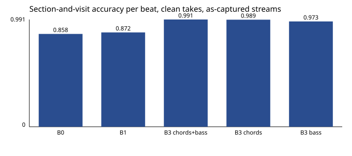
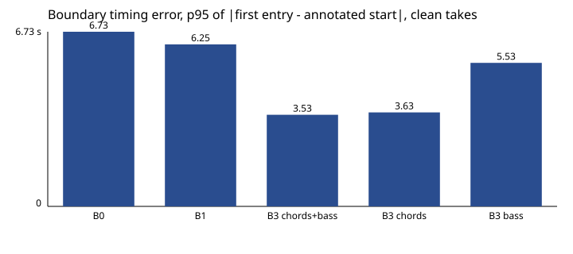
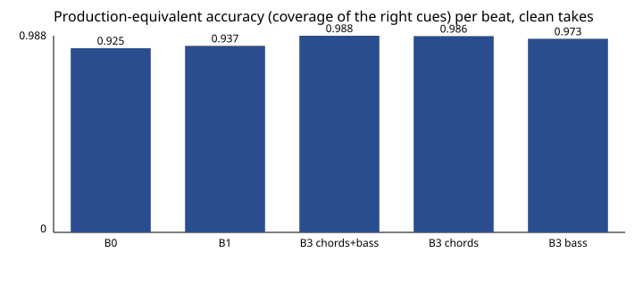

# Synthetic pilot benchmark (SYNTHETIC)

> **SYNTHETIC CORPUS.** These results come from rendered takes and are **not evidence** that following is feasible on real performances (plan Section 9). They test the code.

## Provenance

| Item | Value |
|---|---|
| Protocol | synthetic_pilot |
| Commit | 19a519a450f2a376e4ff24cffd662c4702569e28 |
| Config hash (protocol + song files) | 5998974c14f4ccbf4fdd5b17d94b760906eb0ac5bec0887acd53654976a46464 |
| Methods | B0, B1, B3 |
| Block size | 512 samples |
| Takes | 18 |

Manifest hashes (SHA-256 of each take's `manifest.json`, which itself hashes the audio):

| Take | manifest.json SHA-256 |
|---|---|
| synthetic_anthem/drift | d015e45446956044d4291d72c6bca715fe62b9366ceea845e5d674d717717203 |
| synthetic_anthem/dropout | e2ad5a9f4dc3d832b2c46e7e083cf7bb6fe61493a5a81ba323b9f4cdc2451e7e |
| synthetic_anthem/extend | 4a353308cd0021b1bdeddc6b185d0aa54eec7b898a91f93e1bd92ff986ba96c2 |
| synthetic_anthem/nominal | 65c2aa1e407036b71c8a621da44a3d2cdf1237de306ec2775e2d682db1037565 |
| synthetic_anthem/repeat | d36b9aa6400e219773347c40c0769c020d2c60de83e3266868af5932d052947f |
| synthetic_anthem/skip | 06486667057a60c856f43f51fb392fc4e4e37143884fdbd4ae86c7e5411aa585 |
| synthetic_seven/drift | 27a9405944512d14fcd7ec977141f26cbbbb20b10c4b7b6d56e260c4abc6db0e |
| synthetic_seven/dropout | a403a4e8d122112ae34a4ae4bdfae3fdba05d18ba0e1e1af2bc3e21c48f44d21 |
| synthetic_seven/extend | 4b7a5757e96540fc1a2add6ee84e70e327a42f433fc2ce0a8b444dcf4b071148 |
| synthetic_seven/nominal | 8034c4a3e410490956dadb7481dd4fa6899d6b020d39637614acf6b4a3c1e190 |
| synthetic_seven/repeat | 541dc32c6ddbfd6431e210315a7c2a82ca93675becd8b6888d3fa885d75b7615 |
| synthetic_seven/skip | 5b32c61244076ce33a812d4c7b259e89136cb7eda98447f537f7183373e77db2 |
| synthetic_waltz/drift | ab91702a86e949fc97221d64949b078ab5688eabcf3bab6e4e1a6c49db38e86f |
| synthetic_waltz/dropout | 242bcde5836fa1b90a468feeae86f026cc1053b02e9b70fa315e28ca3bc6d935 |
| synthetic_waltz/extend | f7721081b0c262c781566743cf1f0457146383c49ad9975772fbb3d0f8ff3769 |
| synthetic_waltz/nominal | 464940f20836b027c3630330ac0be8b50ba7f536bf7cd2e43bfecc9a9470f25e |
| synthetic_waltz/repeat | 3f535c590f780ba8c737078d20d6757a6b8ef472b9aced31c0a478397cbedb07 |
| synthetic_waltz/skip | 2460bf70c2176baae66c5aaef55ab551f26935d3819acba8591211232cfc9bd0 |

## Results by method and feed subset

Clean takes, as-captured streams, per annotated beat (the estimate in force at mid-beat). Means over takes; the CSV has every take.

| Method | Feeds | Takes | Section+visit | Bar | Prod.-equiv. | Tempo err | Boundary median (s) | Boundary p95 (s) | Recovered within 2 bars |
|---|---|---|---|---|---|---|---|---|---|
| B0 (Fixed timeline from the annotated song start, at nominal tempo) | drums | 18 | 0.858 | 0.752 | 0.925 | 0.0063 | 2.148 | 6.734 | 1/9 |
| B1 (Beat tracker (onset PLL) plus pure bar counting, no content observation) | drums | 18 | 0.872 | 0.834 | 0.937 | 0.0012 | 1.995 | 6.249 | 1/9 |
| B3 (Bar-grid follower v0 on the listed feeds) | chords+bass | 18 | 0.991 | 0.986 | 0.995 | 0.0012 | 0.022 | 3.533 | 9/9 |
| B3 (Bar-grid follower v0 on the listed feeds) | chords | 18 | 0.989 | 0.984 | 0.993 | 0.0012 | 0.022 | 3.626 | 8/9 |
| B3 (Bar-grid follower v0 on the listed feeds) | bass | 18 | 0.973 | 0.965 | 0.980 | 0.0012 | 0.022 | 5.533 | 6/9 |

### Per take

| Method | Feeds | Take | Section+visit | Bar | Before dev. | After dev. | Recovery (bars) | Unexpected boundaries |
|---|---|---|---|---|---|---|---|---|
| B0 | drums | synthetic_anthem/drift | 0.915 | 0.469 |  |  |  | 0 |
| B1 | drums | synthetic_anthem/drift | 1.000 | 1.000 |  |  |  | 0 |
| B3 | chords+bass | synthetic_anthem/drift | 1.000 | 1.000 |  |  |  | 0 |
| B3 | chords | synthetic_anthem/drift | 1.000 | 1.000 |  |  |  | 0 |
| B3 | bass | synthetic_anthem/drift | 1.000 | 1.000 |  |  |  | 0 |
| B0 | drums | synthetic_anthem/dropout | 1.000 | 1.000 |  |  |  | 0 |
| B1 | drums | synthetic_anthem/dropout | 1.000 | 1.000 |  |  |  | 0 |
| B3 | chords+bass | synthetic_anthem/dropout | 1.000 | 1.000 |  |  |  | 0 |
| B3 | chords | synthetic_anthem/dropout | 1.000 | 1.000 |  |  |  | 0 |
| B3 | bass | synthetic_anthem/dropout | 1.000 | 1.000 |  |  |  | 0 |
| B0 | drums | synthetic_anthem/extend | 0.867 | 0.750 | 1.000 | 0.500 | 4.0 | 1 |
| B1 | drums | synthetic_anthem/extend | 0.867 | 0.750 | 1.000 | 0.500 | 4.0 | 1 |
| B3 | chords+bass | synthetic_anthem/extend | 0.979 | 0.979 | 1.000 | 0.922 | 1.25 | 1 |
| B3 | chords | synthetic_anthem/extend | 0.979 | 0.979 | 1.000 | 0.922 | 1.25 | 1 |
| B3 | bass | synthetic_anthem/extend | 0.958 | 0.958 | 1.000 | 0.844 | 2.5 | 1 |
| B0 | drums | synthetic_anthem/nominal | 1.000 | 1.000 |  |  |  | 0 |
| B1 | drums | synthetic_anthem/nominal | 1.000 | 1.000 |  |  |  | 0 |
| B3 | chords+bass | synthetic_anthem/nominal | 1.000 | 1.000 |  |  |  | 0 |
| B3 | chords | synthetic_anthem/nominal | 1.000 | 1.000 |  |  |  | 0 |
| B3 | bass | synthetic_anthem/nominal | 1.000 | 1.000 |  |  |  | 0 |
| B0 | drums | synthetic_anthem/repeat | 0.875 | 0.828 | 1.000 | 0.333 | 8.0 | 1 |
| B1 | drums | synthetic_anthem/repeat | 0.875 | 0.828 | 1.000 | 0.333 | 8.0 | 1 |
| B3 | chords+bass | synthetic_anthem/repeat | 0.996 | 0.996 | 1.000 | 0.979 | 0.25 | 1 |
| B3 | chords | synthetic_anthem/repeat | 0.992 | 0.992 | 1.000 | 0.958 | 0.5 | 1 |
| B3 | bass | synthetic_anthem/repeat | 0.996 | 0.996 | 1.000 | 0.979 | 0.25 | 1 |
| B0 | drums | synthetic_anthem/skip | 0.417 | 0.417 | 1.000 | 0.000 |  | 1 |
| B1 | drums | synthetic_anthem/skip | 0.417 | 0.417 | 1.000 | 0.000 |  | 1 |
| B3 | chords+bass | synthetic_anthem/skip | 0.958 | 0.885 | 1.000 | 0.929 | 0.5 | 1 |
| B3 | chords | synthetic_anthem/skip | 0.958 | 0.885 | 1.000 | 0.929 | 0.5 | 1 |
| B3 | bass | synthetic_anthem/skip | 0.875 | 0.859 | 1.000 | 0.786 | 6.75 | 1 |
| B0 | drums | synthetic_seven/drift | 0.945 | 0.575 |  |  |  | 0 |
| B1 | drums | synthetic_seven/drift | 1.000 | 1.000 |  |  |  | 0 |
| B3 | chords+bass | synthetic_seven/drift | 1.000 | 0.997 |  |  |  | 0 |
| B3 | chords | synthetic_seven/drift | 1.000 | 0.997 |  |  |  | 0 |
| B3 | bass | synthetic_seven/drift | 0.997 | 0.971 |  |  |  | 0 |
| B0 | drums | synthetic_seven/dropout | 1.000 | 1.000 |  |  |  | 0 |
| B1 | drums | synthetic_seven/dropout | 1.000 | 1.000 |  |  |  | 0 |
| B3 | chords+bass | synthetic_seven/dropout | 1.000 | 0.997 |  |  |  | 0 |
| B3 | chords | synthetic_seven/dropout | 1.000 | 0.997 |  |  |  | 0 |
| B3 | bass | synthetic_seven/dropout | 0.987 | 0.961 |  |  |  | 0 |
| B0 | drums | synthetic_seven/extend | 0.833 | 0.688 | 1.000 | 0.500 | 4.0 | 1 |
| B1 | drums | synthetic_seven/extend | 0.833 | 0.688 | 1.000 | 0.500 | 4.0 | 1 |
| B3 | chords+bass | synthetic_seven/extend | 0.976 | 0.973 | 1.000 | 0.929 | 1.14 | 1 |
| B3 | chords | synthetic_seven/extend | 0.976 | 0.973 | 1.000 | 0.929 | 1.14 | 1 |
| B3 | bass | synthetic_seven/extend | 0.973 | 0.949 | 0.996 | 0.929 | 1.14 | 1 |
| B0 | drums | synthetic_seven/nominal | 1.000 | 1.000 |  |  |  | 0 |
| B1 | drums | synthetic_seven/nominal | 1.000 | 1.000 |  |  |  | 0 |
| B3 | chords+bass | synthetic_seven/nominal | 1.000 | 0.997 |  |  |  | 0 |
| B3 | chords | synthetic_seven/nominal | 1.000 | 0.997 |  |  |  | 0 |
| B3 | bass | synthetic_seven/nominal | 0.997 | 0.971 |  |  |  | 0 |
| B0 | drums | synthetic_seven/repeat | 0.846 | 0.788 | 1.000 | 0.333 | 8.0 | 1 |
| B1 | drums | synthetic_seven/repeat | 0.846 | 0.788 | 1.000 | 0.333 | 8.0 | 1 |
| B3 | chords+bass | synthetic_seven/repeat | 0.997 | 0.995 | 1.000 | 0.988 | 0.14 | 1 |
| B3 | chords | synthetic_seven/repeat | 0.997 | 0.995 | 1.000 | 0.988 | 0.14 | 1 |
| B3 | bass | synthetic_seven/repeat | 0.984 | 0.962 | 0.996 | 0.941 | 0.71 | 1 |
| B0 | drums | synthetic_seven/skip | 0.444 | 0.444 | 1.000 | 0.000 |  | 1 |
| B1 | drums | synthetic_seven/skip | 0.444 | 0.444 | 1.000 | 0.000 |  | 1 |
| B3 | chords+bass | synthetic_seven/skip | 0.988 | 0.984 | 1.000 | 0.979 | 0.43 | 1 |
| B3 | chords | synthetic_seven/skip | 0.988 | 0.984 | 1.000 | 0.979 | 0.43 | 1 |
| B3 | bass | synthetic_seven/skip | 0.968 | 0.956 | 1.000 | 0.943 | 1.14 | 1 |
| B0 | drums | synthetic_waltz/drift | 0.889 | 0.476 |  |  |  | 0 |
| B1 | drums | synthetic_waltz/drift | 1.000 | 1.000 |  |  |  | 0 |
| B3 | chords+bass | synthetic_waltz/drift | 1.000 | 1.000 |  |  |  | 0 |
| B3 | chords | synthetic_waltz/drift | 1.000 | 1.000 |  |  |  | 0 |
| B3 | bass | synthetic_waltz/drift | 1.000 | 1.000 |  |  |  | 0 |
| B0 | drums | synthetic_waltz/dropout | 1.000 | 1.000 |  |  |  | 0 |
| B1 | drums | synthetic_waltz/dropout | 1.000 | 1.000 |  |  |  | 0 |
| B3 | chords+bass | synthetic_waltz/dropout | 1.000 | 1.000 |  |  |  | 0 |
| B3 | chords | synthetic_waltz/dropout | 1.000 | 1.000 |  |  |  | 0 |
| B3 | bass | synthetic_waltz/dropout | 1.000 | 1.000 |  |  |  | 0 |
| B0 | drums | synthetic_waltz/extend | 0.864 | 0.568 | 1.000 | 0.700 | 2.0 | 1 |
| B1 | drums | synthetic_waltz/extend | 0.864 | 0.568 | 1.000 | 0.700 | 2.0 | 1 |
| B3 | chords+bass | synthetic_waltz/extend | 0.992 | 0.992 | 1.000 | 0.983 | 0.33 | 1 |
| B3 | chords | synthetic_waltz/extend | 0.992 | 0.992 | 1.000 | 0.983 | 0.33 | 1 |
| B3 | bass | synthetic_waltz/extend | 0.992 | 0.992 | 1.000 | 0.983 | 0.33 | 1 |
| B0 | drums | synthetic_waltz/nominal | 1.000 | 1.000 |  |  |  | 0 |
| B1 | drums | synthetic_waltz/nominal | 1.000 | 1.000 |  |  |  | 0 |
| B3 | chords+bass | synthetic_waltz/nominal | 1.000 | 1.000 |  |  |  | 0 |
| B3 | chords | synthetic_waltz/nominal | 1.000 | 1.000 |  |  |  | 0 |
| B3 | bass | synthetic_waltz/nominal | 1.000 | 1.000 |  |  |  | 0 |
| B0 | drums | synthetic_waltz/repeat | 0.840 | 0.820 | 1.000 | 0.200 | 8.0 | 1 |
| B1 | drums | synthetic_waltz/repeat | 0.840 | 0.820 | 1.000 | 0.200 | 8.0 | 1 |
| B3 | chords+bass | synthetic_waltz/repeat | 0.993 | 0.993 | 1.000 | 0.967 | 0.33 | 1 |
| B3 | chords | synthetic_waltz/repeat | 0.993 | 0.993 | 1.000 | 0.967 | 0.33 | 1 |
| B3 | bass | synthetic_waltz/repeat | 0.967 | 0.967 | 1.000 | 0.833 | 1.67 | 1 |
| B0 | drums | synthetic_waltz/skip | 0.706 | 0.706 | 1.000 | 0.000 |  | 1 |
| B1 | drums | synthetic_waltz/skip | 0.706 | 0.706 | 1.000 | 0.000 |  | 1 |
| B3 | chords+bass | synthetic_waltz/skip | 0.961 | 0.961 | 1.000 | 0.867 | 1.33 | 1 |
| B3 | chords | synthetic_waltz/skip | 0.931 | 0.931 | 1.000 | 0.767 | 2.33 | 1 |
| B3 | bass | synthetic_waltz/skip | 0.824 | 0.824 | 1.000 | 0.400 | 6.0 | 1 |

## Fault injections

Blocks of the named feed are withheld for the interval (the feed reads `lost`, not silent). Compared with the same method, feeds and take without the fault.

| Fault | Method | Feeds | Take | Section+visit | Clean | Delta |
|---|---|---|---|---|---|---|
| drums_lost_20_30 | B0 | drums | synthetic_anthem/drift | 0.915 | 0.915 | 0.000 |
| chords_lost_40_52 | B0 | drums | synthetic_anthem/drift | 0.915 | 0.915 | 0.000 |
| drums_lost_20_30 | B1 | drums | synthetic_anthem/drift | 0.933 | 1.000 | -0.067 |
| chords_lost_40_52 | B1 | drums | synthetic_anthem/drift | 1.000 | 1.000 | 0.000 |
| drums_lost_20_30 | B3 | chords+bass | synthetic_anthem/drift | 0.933 | 1.000 | -0.067 |
| chords_lost_40_52 | B3 | chords+bass | synthetic_anthem/drift | 1.000 | 1.000 | 0.000 |
| drums_lost_20_30 | B3 | chords | synthetic_anthem/drift | 0.933 | 1.000 | -0.067 |
| chords_lost_40_52 | B3 | chords | synthetic_anthem/drift | 1.000 | 1.000 | 0.000 |
| drums_lost_20_30 | B3 | bass | synthetic_anthem/drift | 0.933 | 1.000 | -0.067 |
| chords_lost_40_52 | B3 | bass | synthetic_anthem/drift | 1.000 | 1.000 | 0.000 |
| drums_lost_20_30 | B0 | drums | synthetic_anthem/dropout | 1.000 | 1.000 | 0.000 |
| chords_lost_40_52 | B0 | drums | synthetic_anthem/dropout | 1.000 | 1.000 | 0.000 |
| drums_lost_20_30 | B1 | drums | synthetic_anthem/dropout | 0.938 | 1.000 | -0.062 |
| chords_lost_40_52 | B1 | drums | synthetic_anthem/dropout | 1.000 | 1.000 | 0.000 |
| drums_lost_20_30 | B3 | chords+bass | synthetic_anthem/dropout | 0.938 | 1.000 | -0.062 |
| chords_lost_40_52 | B3 | chords+bass | synthetic_anthem/dropout | 1.000 | 1.000 | 0.000 |
| drums_lost_20_30 | B3 | chords | synthetic_anthem/dropout | 0.938 | 1.000 | -0.062 |
| chords_lost_40_52 | B3 | chords | synthetic_anthem/dropout | 1.000 | 1.000 | 0.000 |
| drums_lost_20_30 | B3 | bass | synthetic_anthem/dropout | 0.938 | 1.000 | -0.062 |
| chords_lost_40_52 | B3 | bass | synthetic_anthem/dropout | 1.000 | 1.000 | 0.000 |
| drums_lost_20_30 | B0 | drums | synthetic_anthem/extend | 0.867 | 0.867 | 0.000 |
| chords_lost_40_52 | B0 | drums | synthetic_anthem/extend | 0.867 | 0.867 | 0.000 |
| drums_lost_20_30 | B1 | drums | synthetic_anthem/extend | 0.808 | 0.867 | -0.058 |
| chords_lost_40_52 | B1 | drums | synthetic_anthem/extend | 0.867 | 0.867 | 0.000 |
| drums_lost_20_30 | B3 | chords+bass | synthetic_anthem/extend | 0.921 | 0.979 | -0.058 |
| chords_lost_40_52 | B3 | chords+bass | synthetic_anthem/extend | 0.979 | 0.979 | 0.000 |
| drums_lost_20_30 | B3 | chords | synthetic_anthem/extend | 0.921 | 0.979 | -0.058 |
| chords_lost_40_52 | B3 | chords | synthetic_anthem/extend | 0.979 | 0.979 | 0.000 |
| drums_lost_20_30 | B3 | bass | synthetic_anthem/extend | 0.900 | 0.958 | -0.058 |
| chords_lost_40_52 | B3 | bass | synthetic_anthem/extend | 0.958 | 0.958 | 0.000 |
| drums_lost_20_30 | B0 | drums | synthetic_anthem/nominal | 1.000 | 1.000 | 0.000 |
| chords_lost_40_52 | B0 | drums | synthetic_anthem/nominal | 1.000 | 1.000 | 0.000 |
| drums_lost_20_30 | B1 | drums | synthetic_anthem/nominal | 0.938 | 1.000 | -0.062 |
| chords_lost_40_52 | B1 | drums | synthetic_anthem/nominal | 1.000 | 1.000 | 0.000 |
| drums_lost_20_30 | B3 | chords+bass | synthetic_anthem/nominal | 0.938 | 1.000 | -0.062 |
| chords_lost_40_52 | B3 | chords+bass | synthetic_anthem/nominal | 1.000 | 1.000 | 0.000 |
| drums_lost_20_30 | B3 | chords | synthetic_anthem/nominal | 0.938 | 1.000 | -0.062 |
| chords_lost_40_52 | B3 | chords | synthetic_anthem/nominal | 1.000 | 1.000 | 0.000 |
| drums_lost_20_30 | B3 | bass | synthetic_anthem/nominal | 0.938 | 1.000 | -0.062 |
| chords_lost_40_52 | B3 | bass | synthetic_anthem/nominal | 1.000 | 1.000 | 0.000 |
| drums_lost_20_30 | B0 | drums | synthetic_anthem/repeat | 0.875 | 0.875 | 0.000 |
| chords_lost_40_52 | B0 | drums | synthetic_anthem/repeat | 0.875 | 0.875 | 0.000 |
| drums_lost_20_30 | B1 | drums | synthetic_anthem/repeat | 0.820 | 0.875 | -0.055 |
| chords_lost_40_52 | B1 | drums | synthetic_anthem/repeat | 0.875 | 0.875 | 0.000 |
| drums_lost_20_30 | B3 | chords+bass | synthetic_anthem/repeat | 0.941 | 0.996 | -0.055 |
| chords_lost_40_52 | B3 | chords+bass | synthetic_anthem/repeat | 0.996 | 0.996 | 0.000 |
| drums_lost_20_30 | B3 | chords | synthetic_anthem/repeat | 0.938 | 0.992 | -0.055 |
| chords_lost_40_52 | B3 | chords | synthetic_anthem/repeat | 0.992 | 0.992 | 0.000 |
| drums_lost_20_30 | B3 | bass | synthetic_anthem/repeat | 0.941 | 0.996 | -0.055 |
| chords_lost_40_52 | B3 | bass | synthetic_anthem/repeat | 0.996 | 0.996 | 0.000 |
| drums_lost_20_30 | B0 | drums | synthetic_anthem/skip | 0.417 | 0.417 | 0.000 |
| chords_lost_40_52 | B0 | drums | synthetic_anthem/skip | 0.417 | 0.417 | 0.000 |
| drums_lost_20_30 | B1 | drums | synthetic_anthem/skip | 0.344 | 0.417 | -0.073 |
| chords_lost_40_52 | B1 | drums | synthetic_anthem/skip | 0.417 | 0.417 | 0.000 |
| drums_lost_20_30 | B3 | chords+bass | synthetic_anthem/skip | 0.885 | 0.958 | -0.073 |
| chords_lost_40_52 | B3 | chords+bass | synthetic_anthem/skip | 0.922 | 0.958 | -0.036 |
| drums_lost_20_30 | B3 | chords | synthetic_anthem/skip | 0.885 | 0.958 | -0.073 |
| chords_lost_40_52 | B3 | chords | synthetic_anthem/skip | 0.922 | 0.958 | -0.036 |
| drums_lost_20_30 | B3 | bass | synthetic_anthem/skip | 0.802 | 0.875 | -0.073 |
| chords_lost_40_52 | B3 | bass | synthetic_anthem/skip | 0.875 | 0.875 | 0.000 |
| drums_lost_20_30 | B0 | drums | synthetic_seven/drift | 0.945 | 0.945 | 0.000 |
| chords_lost_40_52 | B0 | drums | synthetic_seven/drift | 0.945 | 0.945 | 0.000 |
| drums_lost_20_30 | B1 | drums | synthetic_seven/drift | 0.945 | 1.000 | -0.055 |
| chords_lost_40_52 | B1 | drums | synthetic_seven/drift | 1.000 | 1.000 | 0.000 |
| drums_lost_20_30 | B3 | chords+bass | synthetic_seven/drift | 0.945 | 1.000 | -0.055 |
| chords_lost_40_52 | B3 | chords+bass | synthetic_seven/drift | 1.000 | 1.000 | 0.000 |
| drums_lost_20_30 | B3 | chords | synthetic_seven/drift | 0.945 | 1.000 | -0.055 |
| chords_lost_40_52 | B3 | chords | synthetic_seven/drift | 1.000 | 1.000 | 0.000 |
| drums_lost_20_30 | B3 | bass | synthetic_seven/drift | 0.942 | 0.997 | -0.055 |
| chords_lost_40_52 | B3 | bass | synthetic_seven/drift | 0.997 | 0.997 | 0.000 |
| drums_lost_20_30 | B0 | drums | synthetic_seven/dropout | 1.000 | 1.000 | 0.000 |
| chords_lost_40_52 | B0 | drums | synthetic_seven/dropout | 1.000 | 1.000 | 0.000 |
| drums_lost_20_30 | B1 | drums | synthetic_seven/dropout | 0.945 | 1.000 | -0.055 |
| chords_lost_40_52 | B1 | drums | synthetic_seven/dropout | 1.000 | 1.000 | 0.000 |
| drums_lost_20_30 | B3 | chords+bass | synthetic_seven/dropout | 0.945 | 1.000 | -0.055 |
| chords_lost_40_52 | B3 | chords+bass | synthetic_seven/dropout | 1.000 | 1.000 | 0.000 |
| drums_lost_20_30 | B3 | chords | synthetic_seven/dropout | 0.945 | 1.000 | -0.055 |
| chords_lost_40_52 | B3 | chords | synthetic_seven/dropout | 1.000 | 1.000 | 0.000 |
| drums_lost_20_30 | B3 | bass | synthetic_seven/dropout | 0.932 | 0.987 | -0.055 |
| chords_lost_40_52 | B3 | bass | synthetic_seven/dropout | 0.987 | 0.987 | 0.000 |
| drums_lost_20_30 | B0 | drums | synthetic_seven/extend | 0.833 | 0.833 | 0.000 |
| chords_lost_40_52 | B0 | drums | synthetic_seven/extend | 0.833 | 0.833 | 0.000 |
| drums_lost_20_30 | B1 | drums | synthetic_seven/extend | 0.783 | 0.833 | -0.051 |
| chords_lost_40_52 | B1 | drums | synthetic_seven/extend | 0.833 | 0.833 | 0.000 |
| drums_lost_20_30 | B3 | chords+bass | synthetic_seven/extend | 0.926 | 0.976 | -0.051 |
| chords_lost_40_52 | B3 | chords+bass | synthetic_seven/extend | 0.976 | 0.976 | 0.000 |
| drums_lost_20_30 | B3 | chords | synthetic_seven/extend | 0.926 | 0.976 | -0.051 |
| chords_lost_40_52 | B3 | chords | synthetic_seven/extend | 0.976 | 0.976 | 0.000 |
| drums_lost_20_30 | B3 | bass | synthetic_seven/extend | 0.923 | 0.973 | -0.051 |
| chords_lost_40_52 | B3 | bass | synthetic_seven/extend | 0.973 | 0.973 | 0.000 |
| drums_lost_20_30 | B0 | drums | synthetic_seven/nominal | 1.000 | 1.000 | 0.000 |
| chords_lost_40_52 | B0 | drums | synthetic_seven/nominal | 1.000 | 1.000 | 0.000 |
| drums_lost_20_30 | B1 | drums | synthetic_seven/nominal | 0.945 | 1.000 | -0.055 |
| chords_lost_40_52 | B1 | drums | synthetic_seven/nominal | 1.000 | 1.000 | 0.000 |
| drums_lost_20_30 | B3 | chords+bass | synthetic_seven/nominal | 0.945 | 1.000 | -0.055 |
| chords_lost_40_52 | B3 | chords+bass | synthetic_seven/nominal | 1.000 | 1.000 | 0.000 |
| drums_lost_20_30 | B3 | chords | synthetic_seven/nominal | 0.945 | 1.000 | -0.055 |
| chords_lost_40_52 | B3 | chords | synthetic_seven/nominal | 1.000 | 1.000 | 0.000 |
| drums_lost_20_30 | B3 | bass | synthetic_seven/nominal | 0.942 | 0.997 | -0.055 |
| chords_lost_40_52 | B3 | bass | synthetic_seven/nominal | 0.997 | 0.997 | 0.000 |
| drums_lost_20_30 | B0 | drums | synthetic_seven/repeat | 0.846 | 0.846 | 0.000 |
| chords_lost_40_52 | B0 | drums | synthetic_seven/repeat | 0.846 | 0.846 | 0.000 |
| drums_lost_20_30 | B1 | drums | synthetic_seven/repeat | 0.799 | 0.846 | -0.047 |
| chords_lost_40_52 | B1 | drums | synthetic_seven/repeat | 0.846 | 0.846 | 0.000 |
| drums_lost_20_30 | B3 | chords+bass | synthetic_seven/repeat | 0.951 | 0.997 | -0.047 |
| chords_lost_40_52 | B3 | chords+bass | synthetic_seven/repeat | 0.997 | 0.997 | 0.000 |
| drums_lost_20_30 | B3 | chords | synthetic_seven/repeat | 0.951 | 0.997 | -0.047 |
| chords_lost_40_52 | B3 | chords | synthetic_seven/repeat | 0.997 | 0.997 | 0.000 |
| drums_lost_20_30 | B3 | bass | synthetic_seven/repeat | 0.937 | 0.984 | -0.047 |
| chords_lost_40_52 | B3 | bass | synthetic_seven/repeat | 0.984 | 0.984 | 0.000 |
| drums_lost_20_30 | B0 | drums | synthetic_seven/skip | 0.444 | 0.444 | 0.000 |
| chords_lost_40_52 | B0 | drums | synthetic_seven/skip | 0.444 | 0.444 | 0.000 |
| drums_lost_20_30 | B1 | drums | synthetic_seven/skip | 0.377 | 0.444 | -0.067 |
| chords_lost_40_52 | B1 | drums | synthetic_seven/skip | 0.444 | 0.444 | 0.000 |
| drums_lost_20_30 | B3 | chords+bass | synthetic_seven/skip | 0.921 | 0.988 | -0.068 |
| chords_lost_40_52 | B3 | chords+bass | synthetic_seven/skip | 0.964 | 0.988 | -0.024 |
| drums_lost_20_30 | B3 | chords | synthetic_seven/skip | 0.921 | 0.988 | -0.068 |
| chords_lost_40_52 | B3 | chords | synthetic_seven/skip | 0.901 | 0.988 | -0.087 |
| drums_lost_20_30 | B3 | bass | synthetic_seven/skip | 0.901 | 0.968 | -0.068 |
| chords_lost_40_52 | B3 | bass | synthetic_seven/skip | 0.968 | 0.968 | 0.000 |
| drums_lost_20_30 | B0 | drums | synthetic_waltz/drift | 0.889 | 0.889 | 0.000 |
| chords_lost_40_52 | B0 | drums | synthetic_waltz/drift | 0.889 | 0.889 | 0.000 |
| drums_lost_20_30 | B1 | drums | synthetic_waltz/drift | 0.913 | 1.000 | -0.087 |
| chords_lost_40_52 | B1 | drums | synthetic_waltz/drift | 1.000 | 1.000 | 0.000 |
| drums_lost_20_30 | B3 | chords+bass | synthetic_waltz/drift | 0.913 | 1.000 | -0.087 |
| chords_lost_40_52 | B3 | chords+bass | synthetic_waltz/drift | 1.000 | 1.000 | 0.000 |
| drums_lost_20_30 | B3 | chords | synthetic_waltz/drift | 0.913 | 1.000 | -0.087 |
| chords_lost_40_52 | B3 | chords | synthetic_waltz/drift | 1.000 | 1.000 | 0.000 |
| drums_lost_20_30 | B3 | bass | synthetic_waltz/drift | 0.913 | 1.000 | -0.087 |
| chords_lost_40_52 | B3 | bass | synthetic_waltz/drift | 1.000 | 1.000 | 0.000 |
| drums_lost_20_30 | B0 | drums | synthetic_waltz/dropout | 1.000 | 1.000 | 0.000 |
| chords_lost_40_52 | B0 | drums | synthetic_waltz/dropout | 1.000 | 1.000 | 0.000 |
| drums_lost_20_30 | B1 | drums | synthetic_waltz/dropout | 0.921 | 1.000 | -0.079 |
| chords_lost_40_52 | B1 | drums | synthetic_waltz/dropout | 1.000 | 1.000 | 0.000 |
| drums_lost_20_30 | B3 | chords+bass | synthetic_waltz/dropout | 0.921 | 1.000 | -0.079 |
| chords_lost_40_52 | B3 | chords+bass | synthetic_waltz/dropout | 1.000 | 1.000 | 0.000 |
| drums_lost_20_30 | B3 | chords | synthetic_waltz/dropout | 0.921 | 1.000 | -0.079 |
| chords_lost_40_52 | B3 | chords | synthetic_waltz/dropout | 1.000 | 1.000 | 0.000 |
| drums_lost_20_30 | B3 | bass | synthetic_waltz/dropout | 0.921 | 1.000 | -0.079 |
| chords_lost_40_52 | B3 | bass | synthetic_waltz/dropout | 1.000 | 1.000 | 0.000 |
| drums_lost_20_30 | B0 | drums | synthetic_waltz/extend | 0.864 | 0.864 | 0.000 |
| chords_lost_40_52 | B0 | drums | synthetic_waltz/extend | 0.864 | 0.864 | 0.000 |
| drums_lost_20_30 | B1 | drums | synthetic_waltz/extend | 0.788 | 0.864 | -0.076 |
| chords_lost_40_52 | B1 | drums | synthetic_waltz/extend | 0.864 | 0.864 | 0.000 |
| drums_lost_20_30 | B3 | chords+bass | synthetic_waltz/extend | 0.917 | 0.992 | -0.076 |
| chords_lost_40_52 | B3 | chords+bass | synthetic_waltz/extend | 0.992 | 0.992 | 0.000 |
| drums_lost_20_30 | B3 | chords | synthetic_waltz/extend | 0.917 | 0.992 | -0.076 |
| chords_lost_40_52 | B3 | chords | synthetic_waltz/extend | 0.955 | 0.992 | -0.038 |
| drums_lost_20_30 | B3 | bass | synthetic_waltz/extend | 0.917 | 0.992 | -0.076 |
| chords_lost_40_52 | B3 | bass | synthetic_waltz/extend | 0.992 | 0.992 | 0.000 |
| drums_lost_20_30 | B0 | drums | synthetic_waltz/nominal | 1.000 | 1.000 | 0.000 |
| chords_lost_40_52 | B0 | drums | synthetic_waltz/nominal | 1.000 | 1.000 | 0.000 |
| drums_lost_20_30 | B1 | drums | synthetic_waltz/nominal | 0.921 | 1.000 | -0.079 |
| chords_lost_40_52 | B1 | drums | synthetic_waltz/nominal | 1.000 | 1.000 | 0.000 |
| drums_lost_20_30 | B3 | chords+bass | synthetic_waltz/nominal | 0.921 | 1.000 | -0.079 |
| chords_lost_40_52 | B3 | chords+bass | synthetic_waltz/nominal | 1.000 | 1.000 | 0.000 |
| drums_lost_20_30 | B3 | chords | synthetic_waltz/nominal | 0.921 | 1.000 | -0.079 |
| chords_lost_40_52 | B3 | chords | synthetic_waltz/nominal | 1.000 | 1.000 | 0.000 |
| drums_lost_20_30 | B3 | bass | synthetic_waltz/nominal | 0.921 | 1.000 | -0.079 |
| chords_lost_40_52 | B3 | bass | synthetic_waltz/nominal | 1.000 | 1.000 | 0.000 |
| drums_lost_20_30 | B0 | drums | synthetic_waltz/repeat | 0.840 | 0.840 | 0.000 |
| chords_lost_40_52 | B0 | drums | synthetic_waltz/repeat | 0.840 | 0.840 | 0.000 |
| drums_lost_20_30 | B1 | drums | synthetic_waltz/repeat | 0.773 | 0.840 | -0.067 |
| chords_lost_40_52 | B1 | drums | synthetic_waltz/repeat | 0.840 | 0.840 | 0.000 |
| drums_lost_20_30 | B3 | chords+bass | synthetic_waltz/repeat | 0.927 | 0.993 | -0.067 |
| chords_lost_40_52 | B3 | chords+bass | synthetic_waltz/repeat | 0.993 | 0.993 | 0.000 |
| drums_lost_20_30 | B3 | chords | synthetic_waltz/repeat | 0.927 | 0.993 | -0.067 |
| chords_lost_40_52 | B3 | chords | synthetic_waltz/repeat | 0.993 | 0.993 | 0.000 |
| drums_lost_20_30 | B3 | bass | synthetic_waltz/repeat | 0.900 | 0.967 | -0.067 |
| chords_lost_40_52 | B3 | bass | synthetic_waltz/repeat | 0.967 | 0.967 | 0.000 |
| drums_lost_20_30 | B0 | drums | synthetic_waltz/skip | 0.706 | 0.706 | 0.000 |
| chords_lost_40_52 | B0 | drums | synthetic_waltz/skip | 0.706 | 0.706 | 0.000 |
| drums_lost_20_30 | B1 | drums | synthetic_waltz/skip | 0.608 | 0.706 | -0.098 |
| chords_lost_40_52 | B1 | drums | synthetic_waltz/skip | 0.706 | 0.706 | 0.000 |
| drums_lost_20_30 | B3 | chords+bass | synthetic_waltz/skip | 0.863 | 0.961 | -0.098 |
| chords_lost_40_52 | B3 | chords+bass | synthetic_waltz/skip | 0.892 | 0.961 | -0.069 |
| drums_lost_20_30 | B3 | chords | synthetic_waltz/skip | 0.833 | 0.931 | -0.098 |
| chords_lost_40_52 | B3 | chords | synthetic_waltz/skip | 0.863 | 0.931 | -0.069 |
| drums_lost_20_30 | B3 | bass | synthetic_waltz/skip | 0.726 | 0.824 | -0.098 |
| chords_lost_40_52 | B3 | bass | synthetic_waltz/skip | 0.824 | 0.824 | 0.000 |

## Assistance accounting

What each method was told, beyond the audio (audit F-12). Every method here is anchored at the **annotated song start**: it is told about exactly one boundary, the first, at time zero relative to it, by annotation. No method receives existing MIDI (B5) or simulated presses (B6); those methods are not built. Conclusions therefore read as audio-only results with the song start given.

| Method | Boundaries in corpus | Told about | By which input | When |
|---|---|---|---|---|
| B0 | 126 | 1 per take (song start) | annotation | at the boundary (0 s) |
| B1 | 126 | 1 per take (song start) | annotation | at the boundary (0 s) |
| B3 | 126 | 1 per take (song start) | annotation | at the boundary (0 s) |

## Failure examples

| Method | Feeds | Take | Section+visit | What happened |
|---|---|---|---|---|
| B0 | drums | synthetic_anthem/skip | 0.417 | never recovered after the skip (before 1.000, after 0.000) |
| B1 | drums | synthetic_anthem/skip | 0.417 | never recovered after the skip (before 1.000, after 0.000) |
| B0 | drums | synthetic_seven/skip | 0.444 | never recovered after the skip (before 1.000, after 0.000) |
| B1 | drums | synthetic_seven/skip | 0.444 | never recovered after the skip (before 1.000, after 0.000) |
| B0 | drums | synthetic_waltz/skip | 0.706 | never recovered after the skip (before 1.000, after 0.000) |
| B1 | drums | synthetic_waltz/skip | 0.706 | never recovered after the skip (before 1.000, after 0.000) |

## Reduced scope

- B2: deferred, not built. Linear online DTW against the reference take (P1; the pymatchmaker cross-check with it)
- B4: deferred, not built. Bar-grid follower on isolated feeds, audio only (the synthetic corpus has no room mic, so B3 here already runs on isolated feeds)
- B5: deferred, not built. B4 plus existing MIDI and controller events
- B6: deferred, not built. B5 plus simulated performer presses at 50% of boundaries
- Features: drum-band pattern and vocal activity (T-10 P1) are deferred; onset and chroma only.
- Ablations: with and without the duration prior, and with and without the transition graph, are deferred.
- Takes: synthetic only; no pilot take has been recorded (WP5).

## Streams and the idealized label

Every result above was computed on the takes' **as-captured** streams: each block became available when its last sample was captured, and nothing read past that moment (I-9). No result in this report is **idealized** (computed on drift-corrected streams); the benchmark has no corrected-stream path, so the `idealized` column in `results.csv` is `false` throughout. Wall-clock per run is in `timing.csv`, measured on the machine that produced this report, and is not part of the reproducibility claim.
